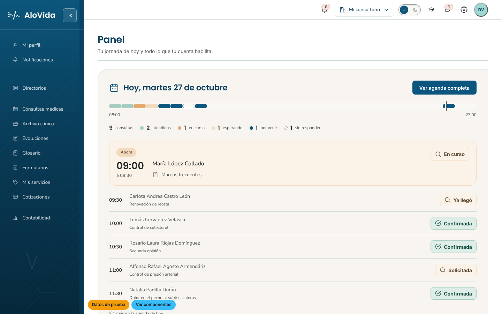
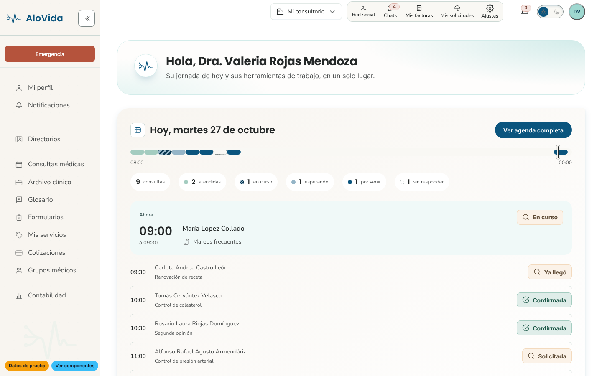
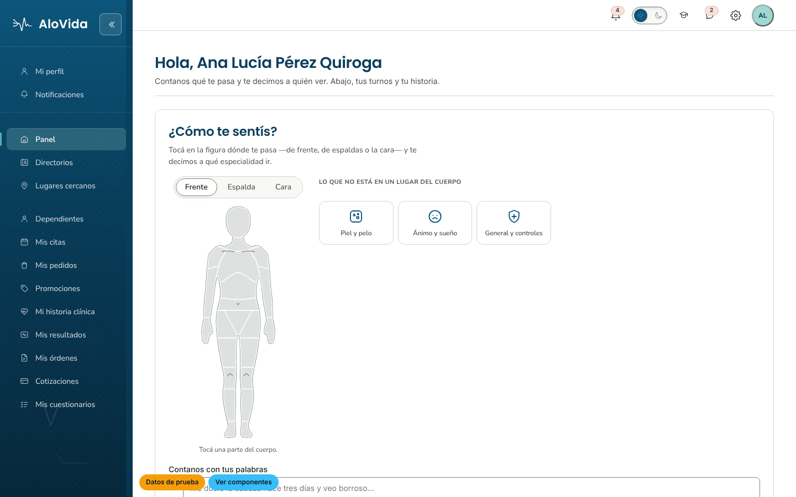
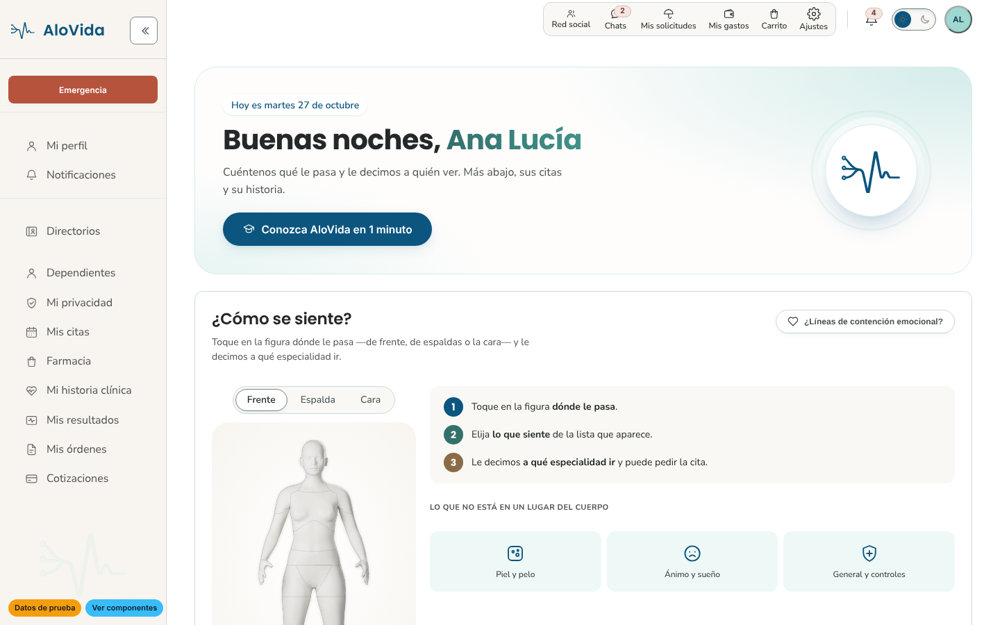

# Bajar el azul — volver a la proporción de la línea gráfica

**Pedido del cliente (27/10/2026):** «Está muy azul, corregilo. Hay que corregir
todos los puntos del azul de la línea gráfica».

**Referencia:** `SALUD/Arquitectura/identidad-visual.md` (repo de documentación),
Partes 2, 3 y 4.

## Qué estaba fuera de la línea gráfica

| # | Punto | Lo que había | Lo que dice la línea gráfica | Corrección |
|---|---|---|---|---|
| 1 | Barra lateral en claro | Petróleo `#0B557E` de arriba abajo, con viñeta y degradado aún más oscuros | `--bg-surface-alt` = marfil-400 `#F8F5F0` para «secciones secundarias, sidebar» (Parte 3). Proporción: «blanco = base, petróleo = acción» (Parte 4) | Barra marfil, borde salvia, tinta neutra; isotipo y palabra en petróleo; activo en aguamarina |
| 2 | Títulos, rótulos, celdas, selects, pestañas | `--tinta-marca: #0A3E5C`, un azul que **no está en la rampa** | Títulos y cuerpo en `--text-primary` = neutral-500 `#242828` (Parte 3) | `--tinta-marca` pasa a `#242828` (≈60 usos de una vez) |
| 3 | Tinta en oscuro | Celeste `#CFE7F2` / `#A3C4D4` / `#7C97A5`, y títulos `#BFE4F5` | «El marfil pasa de papel a tinta» (Parte 4) | Marfil `#F6F3ED`, salvia-200 `#E9EEED`, salvia-600 `#A5B0AD` |
| 4 | Fondo vivo y halos | Celeste `rgba(122,191,232,…)` | «Azul petróleo saturado, no celeste de stock» (Parte 2) | Aguamarina / menta |
| 5 | Enlaces en oscuro | Petróleo aclarado `#12719F`, 3,4:1 (R3 de `check-contrast`) | En oscuro «la aguamarina acciona» (Parte 4) | Ya resuelto en `dev` (`:where(a[app-link])` con `--brand-primary`); se conserva |
| 6 | Título de la cinta del rediseño (22/10) | `petrol-700` en claro, `aqua-300` en oscuro | Títulos en `--text-primary` | Tinta; el color lo pone la cinta |
| 7 | Saludo, día de la próxima cita y fecha de turnos del paciente | `petrol-700` | Títulos en `--text-primary` | Tinta; el nombre del saludo pasa de petróleo→aqua a aqua-700→aqua-600 |
| 8 | Tarjeta «Ahora» del panel del médico | Fondo `--st-primary-bg` (petróleo-50) | Aguamarina/menta para estados activos (Parte 2) | `--st-secondary-*` (menta) |
| 9 | Fichas de síntomas del paciente | Petróleo al 9 % | Menta: «fondos secundarios» (Parte 2) | Menta al 18 % |
| 10 | Anillo de foco del nav | Menta, pensado para el nav petróleo: 1,46:1 sobre el marfil | 3:1 (WCAG 1.4.11) | aqua-700 en claro (5,25:1), menta en oscuro (11,38:1); `check-contrast` mide contra `--nav-carril` |

En **oscuro** la barra sigue siendo petróleo a propósito: ahí la línea gráfica sí
pide que las superficies sean la rampa del azul.

## Lo que no se tocó, y por qué

- **Botón primario en petróleo**: es exactamente el rol que la línea gráfica le da
  al petróleo en claro («acción primaria»).
- **Columna de marca del ingreso** (`auth-split`): degradado aqua → petróleo,
  todo en paleta y diseñado como escenario fijo detrás del texto blanco. Si se
  quiere aclarar también, es una decisión aparte.
- **Botones del simulador** («Datos de prueba», «Ver componentes»): herramienta
  del modo demo, fuera del producto; sus colores ajenos son a propósito.
- **Tilde de leído del chat** (`#3B9EDB`): convención de mensajería.

## Evidencia (navegador, 1440 × 900)

Las capturas «antes» son de la base `master`, contra la que se hizo el primer
pase. Las «después» son de esta rama sobre `dev` (`ng serve --configuration
demo`, backend simulado).

| Antes | Después |
|---|---|
|  |  |
|  |  |

- Agenda en claro: `evidencia/despues-agenda-claro.png`
- Agenda en oscuro: `evidencia/despues-agenda-oscuro.png`
- Cajón a 390 px: `evidencia/despues-cajon-390.png`

## Gates (sobre `dev`)

- `node scripts/check-contrast.mjs`: OK (`--tinta-marca` en oscuro 15,08:1;
  anillo de foco del nav 5,25:1 en claro y 11,38:1 en oscuro).
- `node scripts/check-tokens.mjs`: OK.
- `node scripts/check-css-tokens.mjs`: los mismos 4 tokens faltantes que `dev`.
- `ng test` sobre shell-layout, alovida-shell, core/alovida, core/layout,
  dashboard, symptom-check, side-nav y link: 23 archivos, 497/497.
- `ng build --configuration development`: OK.
- `eslint` sobre las plantillas tocadas: 0.

**Revisión visual independiente:** pendiente (`NO_SELF_APPROVAL`).
