# 01 — Flujos de usuario y de datos: inventario, diagramas y árboles de decisión

- Fecha: 2026-10-30 · Peldaño: `DISCOVERED` (solo lectura de código; no se arrancó nada, no se corrió ningún test).
- Rutas: `API` = `/home/user/mantra-core-health-api` · `FRONT` = `/home/user/mantra-core-health` · `ATLAS` = `/home/user/pabloarauzcaballero/atlasadminportal`. Las rutas `src/modules/...` son de `API`.
- Convención de líneas: donde dice «inv.» la línea sale de `inventario/endpoints/*.json` (`codigo.fuente`), que apunta al **primer decorador** del handler, no al `@Post`. Donde el `@Post`/`throw` se leyó directamente, la línea es la exacta.
- No hay PII/PHI en este documento (solo rutas, nombres de tablas y de clases).

## 0. Hallazgo de partida: hay DOS fuentes de «flujos» en la API y no son lo mismo

| | Catálogo de flujos QA (`/admin/qa/flows*`) | Inventario del portal (`/admin/portal/flujos*`) |
|---|---|---|
| Qué es | Recorridos de usuario **curados a mano** en JSON, con ramas válidas/límite/inválidas y caso de prueba | Procesos **derivados del código** (controladores, servicios, tablas) con grafo y árbol por operación |
| Fuente | `src/modules/qa_lab/domain/flows/catalog/*.flow.json`, registrados en `domain/flows/index.ts:5-14` | `inventario/**` en `API` (291 archivos versionados, `git ls-files inventario`), servidos por `InventoryRepository` (`src/modules/data_catalog/infrastructure/repositories/inventory.repository.ts:1-80`) |
| Controlador | `src/modules/qa_lab/presentation/controllers/qa-lab-read.controller.ts:134-152` (`GET admin/qa/flows`, `GET admin/qa/flows/:flowId`; roles `QA_ADMIN, QA_ENGINEER, RELEASE_MANAGER, PLATFORM_ADMIN`, `:27-32`) | `src/modules/data_catalog/presentation/controllers/admin-portal.controller.ts:56-160` (`GET admin/portal/operaciones[/:id[/arbol]]`, `flujos`, `flujos/mapa`, `flujos/:codigo[/grafo]`, `linaje`) |
| Volumen hoy | **3 flujos** (1.3, 2.6, 2.7), 43 nodos | **74 procesos** (72 `MODULO` + 2 `CRITICO`), **1 642 operaciones**, 12 máquinas de estado |
| Front que ya lo pinta | `FRONT/src/app/features/admin/flows/*` (`flows.ts`, `flow-detail`, `flow-tree`) | `FRONT/src/app/features/admin/portal/{processes,process-diagram,operations,lineage,route-map}` |
| Qué NO trae | Tablas, servicios, repositorios, eventos | Ramas de negocio, casos válidos/límite/inválidos, quién llama desde qué pantalla |

Conteos del segundo salen de `inventario/flujos/procesos.json` (74 elementos), `inventario/endpoints/*.json` (1 642 operaciones) y `inventario/flujos/maquinas.json` (12 máquinas) — contados con un script ad hoc, no hay otro lugar donde estén escritos.

## 1. Flujos que ya expone la API (catálogo QA)

Forma de cada flujo (`FlowDetail`, `FRONT/src/app/core/data-access/admin-portal/flows.types.ts:139-153`; origen `qa-flows.service.ts:177-200`): `id, module, title, source, actors[], frontRoutes[], root, openQuestions[], counts, contract, qa, nodes[]`. Cada nodo: `kind (SCREEN|API_CALL|DECISION|OUTCOME), actor, uiRoute, endpoint{method,path,operationId,contract DECLARED|MISSING}, gap, effects[], sourceRef, branches[]`; cada rama: `kind (HAPPY_PATH=válido|EDGE=límite|NEGATIVE=inválido), condition, expected, next, loopsTo, reason, qaCase{método, ruta, estado esperado, observedOn, seeded, drifted, lastResult}` (`flows.types.ts:91-137`). La API **no** devuelve cuerpos ni cabeceras de los casos (`qa-flows.service.ts:93-99`).

| Id | Nombre | Módulo del Registro | Nodos | Llamadas API | `gap` (paso sin endpoint) | Ramas (válida/límite/inválida) | Ramas con caso / sin caso | Fuente |
|---|---|---|---|---|---|---|---|---|
| 1.3 | Agendar hora para consultas médicas | 1 · Paciente | 15 | 11 | 2 (`datos-facturacion`, `aviso-cupo-libre`) | 13 / 3 / 8 | 13 / 11 | `1.3.flow.json` (nodo `datos-facturacion` :353, `aviso-cupo-libre` :442) |
| 2.6 | Consulta y elaboración de la ficha médica (sin seguro) | 2 · Médico | 13 | 10 | 2 (`enlace-paciente` :104, `cronograma-medicamentos` :331) | 12 / 1 / 8 | 9 / 12 | `2.6.flow.json` |
| 2.7 | Facturación y/o pago por la consulta médica | 2 · Médico | 15 | 10 | 5 (`qr-monto-total` :38, `qr-coaseguro`, `comprobante-pago` :134, `datos-facturacion` :151, `programar-facturacion` :299) | 13 / 3 / 5 | 5 / 16 | `2.7.flow.json` |

(Conteos calculados leyendo los JSON; el README del módulo confirma «Hoy hay tres», `domain/flows/README.md:8`.)

**Observaciones sobre los 3 flujos (hipótesis a verificar, no hechos):**

1. El `gap` `qr-monto-total`/`comprobante-pago` de 2.7 puede estar desactualizado: la API sí monta `PUT /practitioners/me/sites/{siteId}/bank-qr` (`practice/controllers/practitioner-sites.controller.ts:169-185`, P33, el profesional fija su QR bancario por sede) y `POST /scheduling/bookings/{id}/payment-receipts` (+ `confirm`/`reject`; `scheduling/presentation/controllers/scheduling-bookings.controller.ts:313-406`, el paciente sube comprobante y el prestador lo confirma). No emiten «un QR por un monto», pero cubren parte del paso. Hay que contrastar con el texto del cliente antes de cambiar el `gap` (`docs/requisitos/REQUISITOS-CLIENTE-ALOVIDA.md:286-311` en `AlovidaPromptManager`).
2. El flujo 1.3 modela la reserva con `POST /scheduling/holds/{holdToken}/confirm`, pero el camino real del **paciente** es `POST /scheduling/holds/{holdToken}/request` (queda `PENDING_CONFIRMATION` hasta que el profesional acepta): `confirm` lo documenta el propio caso de uso como «entrada del mostrador» (`scheduling/application/bookings/use-cases/confirm-booking.use-case.ts:20-31`). Ver flujo C2 abajo.
3. La numeración `1.x/2.x` coincide con el orden de secciones del documento del cliente (Paciente: Registro `:50`, Registro con link `:87`, Agendar `:102`, Laboratorios `:113`, Recepción del link `:118`; Médico: Registro `:192`, Facturación `:229`, Horarios `:245`, Calendario `:250`, Recepción `:256`, Consulta `:273`, Facturación consulta `:286`; todo en `AlovidaPromptManager/docs/requisitos/REQUISITOS-CLIENTE-ALOVIDA.md`). El «Registro de procesos por módulo» de la bóveda no está en este workspace, así que **la numeración que propongo abajo para los flujos nuevos es deducida y no verificada** contra él.

## 2. Flujos reales que FALTAN en el catálogo (≥ 25, deducidos de controladores/servicios)

Leyenda de «Estado»: **EXISTE** = ya en el catálogo QA · **FALTA** = no está. «Ancla» = endpoint de entrada con su archivo:línea. El campo «Id propuesto» es la sección del Registro del cliente a la que corresponde cuando la hay (no verificado, ver punto 3 arriba); `—` = no hay sección del cliente, sería flujo técnico.

| Dominio | # | Flujo (de punta a punta) | Estado | Ancla (método ruta · archivo:línea) | Id propuesto |
|---|---|---|---|---|---|
| Identidad | I1 | Login, sesión, MFA opcional y bloqueo de cuenta | FALTA | `POST /iam/auth/login` · `iam/presentation/controllers/iam-auth.controller.ts:354` | — |
| Identidad | I2 | Registro de paciente con documento (cuenta usable al instante, correo opcional) | FALTA | `POST /iam/auth/register-patient` · `iam-auth.controller.ts:113` | 1.1 (`REQUISITOS…:50`) |
| Identidad | I3 | Verificación de correo, reenvío y activación con token de un solo uso | FALTA | `POST /iam/auth/verify-email` `:319`, `resend-verification` (inv. `:299`), `activate` (inv. `:332`) · `iam-auth.controller.ts` | 1.2 (`:87`) |
| Identidad | I4 | Registro de profesional + verificación de identidad y de licencia | FALTA | `POST /iam/auth/register-practitioner` (inv. `:266`); `POST /identity/me/practitioner/{identity,license}-verification` · `identity_assurance/controllers/identity-self-service.controller.ts:60,78` | 2.1 (`:192`) |
| Identidad | I5 | Refresh con rotación y detección de reuso; logout / logout-all | FALTA | `POST /iam/auth/token/refresh` · `iam-auth.controller.ts:424` (reuso detectado: `iam-auth.service.ts:655`) | — |
| Citas | C1 | Agendar consulta (búsqueda → cupo → hold → cita) | **EXISTE (1.3)** | `POST /scheduling/slots/{id}/holds` · `scheduling/presentation/controllers/scheduling.controller.ts:693` | 1.3 |
| Citas | C2 | Solicitud del paciente → aceptar / rechazar / proponer otro horario / pedir información | FALTA | `POST /scheduling/holds/{holdToken}/request` `scheduling.controller.ts:744`; `POST /scheduling/bookings/{id}/{accept,reject,propose-schedule,request-info}` (inv. `scheduling-bookings.controller.ts:156,233,212,184`) | 1.3 / 2.4 |
| Citas | C3 | Cancelar, reprogramar, no-show y liberación de cupo | FALTA | `POST /scheduling/bookings/{id}/cancel` (inv. `:500`), `reschedule` (inv. `:479`) · `scheduling-bookings.controller.ts` | 1.3 / 2.4 |
| Citas | C4 | Lista de espera → promoción por worker → aviso de cupo libre | FALTA (en 1.3 hay 2 nodos y 1 `gap`) | `POST /scheduling/waitlist` `scheduling.controller.ts:766`; `POST /scheduling/internal/promote-waitlist/{slotId}` (inv. `scheduling-internal.controller.ts:82`) | 1.3 |
| Citas | C5 | Comprobante de pago de la cita (subir → confirmar/rechazar) | FALTA | `POST /scheduling/bookings/{id}/payment-receipts` `scheduling-bookings.controller.ts:313`, `…/{receiptId}/confirm` `:384` | 2.7 |
| Citas | C6 | Check-in, inicio y término de la cita (máquina `BOOKING_TRANSITIONS`) | FALTA | `POST /scheduling/bookings/{id}/{check-in,start,complete}` (inv. `:522,434,458`) | 2.5 (`:256`) |
| Historia clínica | H1 | Consulta y ficha médica | **EXISTE (2.6)** | `POST /charts/notes` · `chart/controllers/chart-notes.controller.ts:99` | 2.6 |
| Historia clínica | H2 | Cierre sellado de la consulta (hash + aviso al paciente) | FALTA | `POST /clinical/encounters/{id}/close` · `clinical/controllers/clinical-encounters.controller.ts:107` → `clinical/services/encounters.service.ts:370-470` | 2.6 |
| Historia clínica | H3 | Nota: firmar, cofirmar, enmendar, liberar/retener al paciente | FALTA | `POST /charts/notes/{noteId}/versions/{versionId}/{sign,cosign}`, `…/amendments`, `versions/{versionId}/{release,withhold}` · `chart-notes.controller.ts:137,155,173,190,207` | 2.6 |
| Historia clínica | H4 | Solicitud de acceso del profesional al paciente → decisión del paciente → grant | FALTA | `POST /consent/practitioner-access-requests` `consent/controllers/practitioner-access-requests.controller.ts:36`, `…/{id}/decision` `:68` | — |
| Historia clínica | H5 | Retiro de consentimiento y revocación inmediata del acceso | FALTA | `POST /consent/me/consents/{id}/withdraw` · `consent/controllers/consent-me.controller.ts:83` | — |
| Historia clínica | H6 | Acceso de emergencia (break-the-glass) auditado | FALTA | `POST /authz/patients/{patientProfileId}/break-the-glass` · `authz/controllers/authz-clinical.controller.ts:61` | — |
| Farmacia | F1 | Receta (borrador → firma → emisión) | FALTA (en 2.6 son 2 nodos) | `POST /clinical/medication-requests` `clinical/controllers/clinical-records.controller.ts:227`, `…/{id}/issue` `:332` | 2.6 |
| Farmacia | F2 | Pedido de farmacia: crear → revisar → confirmar/sustituir → listo → dispensar con código de retiro | FALTA | `POST /pharmacy/orders` · `pharmacy_inventory/presentation/controllers/pharmacy-orders.controller.ts:94`; `…/{id}/dispense` `:345` | 3.2 (`:341`) |
| Farmacia | F3 | Inventario: reserva, recall, conteo y recepción de compras | FALTA | `POST /pharmacy/{pharmacyId}/reservations` · `pharmacy-inventory.controller.ts:84`; `POST /pharmacy/recall-holds` `:159` | 3.1 (`:315`) |
| Laboratorio | L1 | Orden clínica → recepción en laboratorio → muestra → resultado → liberación → paciente | FALTA (en 2.6 son 2 nodos) | `POST /clinical/service-requests` · `clinical/controllers/clinical-orders.controller.ts:82`; `POST /diagnostics/specimens` `diagnostics/controllers/diagnostics-specimens.controller.ts:57` | 1.4 (`:113`), 4.x (`:416`) |
| Laboratorio | L2 | Resultado crítico: detectar → acuse del clínico | FALTA | `POST /diagnostics/critical-results` `diagnostics-reports.controller.ts:79`, `…/{id}/acknowledge` `:95` | — |
| Laboratorio | L3 | Imagen / estudios (DICOMweb, dosis, calidad de datos) | FALTA | `POST /dicomweb/studies` · `diagnostics-imaging.controller.ts:110` | 5.x (`:454`) |
| Seguros | S1 | Elegibilidad → autorización previa → reclamo → adjudicación → EOB | FALTA | `POST /coverage-eligibility-requests` `insurance/presentation/controllers/coverage.controller.ts:101`; `POST /prior-authorization-requests` `prior-auth.controller.ts:96`; `POST /insurance-claims` `claims.controller.ts:100` | 2.7 (`:298`), 6.x (`:520`) |
| Seguros | S2 | Disputa y apelación de un reclamo | FALTA | `POST /insurance-claims/{id}/disputes` `claims.controller.ts:220`; `POST /claim-disputes/{id}/appeal-decisions` `appeals.controller.ts:37` | 6.x |
| Seguros | S3 | Aseguradora recibe reclamo y decide | FALTA | `POST /insurance/received-claims/{id}/decision` · `insurer-received-claims.controller.ts:96` | 6.x (`:547`) |
| Facturación/pagos | B1 | Facturación de la consulta (sin/con seguro) | **EXISTE (2.7)** | `POST /billing/simulated/charges/{chargeId}/payment` · `billing/controllers/billing-simulated.controller.ts:61` | 2.7 |
| Facturación/pagos | B2 | Pago por pasarela: intención → checkout → callback firmado → estado | FALTA | `POST /payments/intents` `payments/controllers/payments-intents.controller.ts:54`; `POST /payments/callbacks/{callbackPath}` `payments-operations.controller.ts:95` | pasarela (`:575`) |
| Contabilidad | B3 | Asiento contable: clasificar → aprobar → contabilizar → revertir | FALTA | `POST /accounting/journal-transactions` `accounting/controllers/accounting-ledger.controller.ts:189`, `…/{id}/{classify,approve,post,reverse}` (inv. `:232,268,286`) | — |
| Mensajería | M1 | Notificación: solicitud → outbox → relay → entrega → recibo del proveedor | FALTA | `POST /notifications/requests` `messaging/controllers/messaging.controller.ts:97`; `POST /internal/outbox/relay/run` (inv. `messaging-internal.controller.ts:78`); `POST /webhooks/providers/{providerCode}/receipts` (inv. `provider-webhooks.controller.ts:33`) | — |
| Mensajería | M2 | Conversación paciente–profesional (chat) | FALTA | `POST /community/conversations` `community/controllers/community-messaging.controller.ts:70`, `…/{id}/messages` `:86` | — |
| Comunidad | K1 | Publicación en grupo, reporte, cola de moderación, apelación | FALTA | `POST /community/groups/{groupId}/posts` `community-groups.controller.ts:164`; `POST /community/reports` `community-moderation.controller.ts:61` | — |
| Comunidad | K2 | Reseña de un profesional y su respuesta | FALTA | `POST /community/profiles/{profileId}/reviews` · `community-reviews.controller.ts:51` | — |
| Telemetría | T1 | Consentimiento de seguimiento → captura de eventos → cierre de sesión → embudos admin | FALTA | `POST /telemetry/tracking-consents` `telemetry/controllers/telemetry-consent.controller.ts:64`; `POST /telemetry/activity-events` `telemetry-events.controller.ts:45`; `GET /admin/analytics/overview` `telemetry-analytics.controller.ts:121` | — |
| Telemetría | T2 | Encuesta de satisfacción: invitación → respuesta | FALTA | `POST /surveys/me/invitations/{id}/responses` · `surveys/controllers/surveys-patient.controller.ts:61` | — |

Recuento: 31 flujos listados, 3 ya existen (C1, H1, B1), **28 faltan**. No se listaron módulos de plataforma (ERP, lakehouse, vector_rag, etc.: 74 procesos en `procesos.json`) porque no tienen recorrido de usuario final.

**Dos huecos del cliente sin ningún endpoint ancla encontrado:** «Compras de supermercados» (`REQUISITOS…:366`) y «Módulo de puntos/promociones» (`:373`, `:381`): existe `promotions` (20 operaciones en `procesos.json`) pero no se leyó su controlador; **no verificado** si cubre el recorrido.

---

## 3. Ocho flujos clave: flujo de datos + árbol de decisión

Cada par de diagramas: (a) **flujo de datos** cliente → endpoint → servicio → repositorio → tabla; (b) **árbol de decisión** con validación, autorización, errores del contrato y estados. Los nombres de clase y las tablas salen de `via` de `inventario/endpoints/*.json` (cadena de llamadas estática) y se cotejaron con el código donde hay `file:línea`. Una tabla con confianza `POR_TIPO`/`POR_SQL` (no `DIRECTA`) es inferencia estática; se marca.

### F1 · I1 — Login, sesión y bloqueo

**Datos**

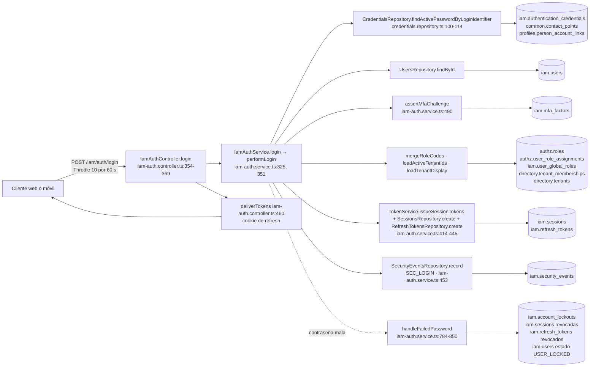

**Árbol de decisión**

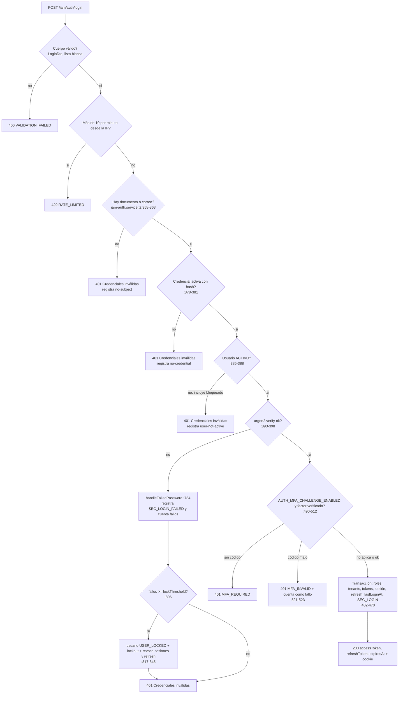

Notas: el mismo 401 «Credenciales inválidas» para cuatro causas distintas es deliberado (anti-enumeración; comentario en `iam-auth.service.ts:381`). Respuestas posibles del contrato: 200, 400 `VALIDATION_FAILED`, 401 `UNAUTHENTICATED`, 429 `RATE_LIMITED` (`inventario/endpoints/iam.json`, op `IamAuthController_login`). `iam.users` y `iam.account_lockouts` figuran como escritura con confianza `POR_TIPO` (inferencia), el resto `DIRECTA`.

---

### F2 · I2 — Registro de paciente

**Datos**

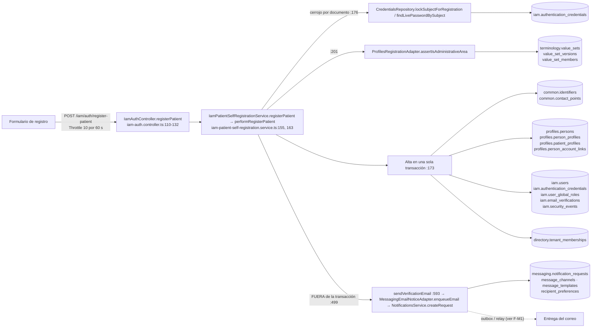

**Árbol de decisión**

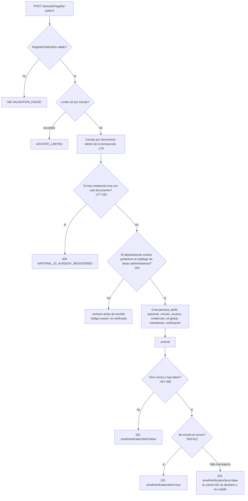

Notas: contrato 201, 400, 401, 409 `CONFLICT`, 422 `PRECONDITION_FAILED`, 429 (`inventario/endpoints/iam.json`, `IamAuthController_registerPatient`). El 401 aparece en el contrato aunque la ruta es `@Public()`; **no verificado** de dónde sale.

---

### F3 · C1 + C2 — Agendar cita (cupo, hold, solicitud, aceptación)

**Datos**

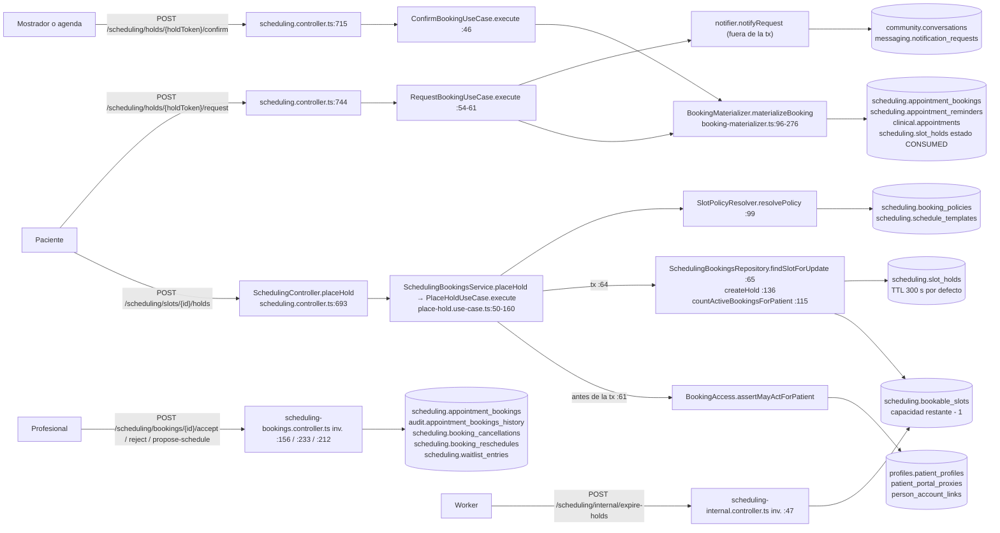

**Árbol de decisión (reserva y solicitud)**

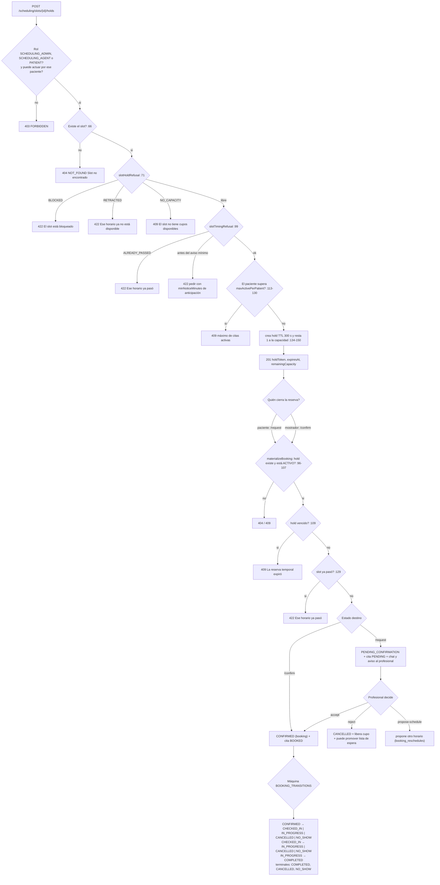

Notas: la máquina de estados está en `scheduling/domain/booking/booking-state-machine.ts:33-61`; la reprogramación **no** es una transición (`:25-28`). El cupo se toma con `findSlotForUpdate` (nombre y comentario `place-hold.use-case.ts:65`); el `SELECT ... FOR UPDATE` literal vive en el repositorio y no se leyó. `confirm` y `request` terminan en el mismo `materializeBooking` y difieren solo en el estado (`confirm-booking.use-case.ts:46-60` vs `request-booking.use-case.ts:54-61`).

---

### F4 · H1 + H2 + F1 — Consulta: nota, cierre sellado y receta

**Datos**

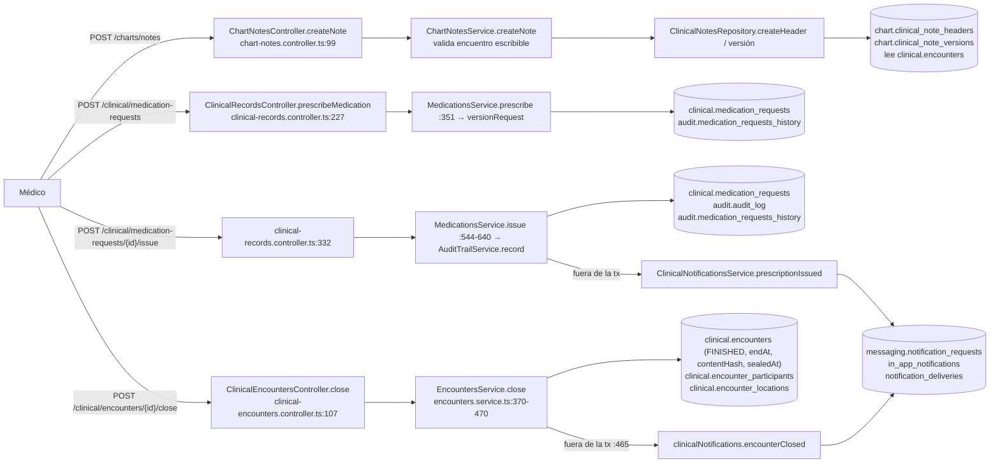

**Árbol de decisión (emitir receta y cerrar consulta)**

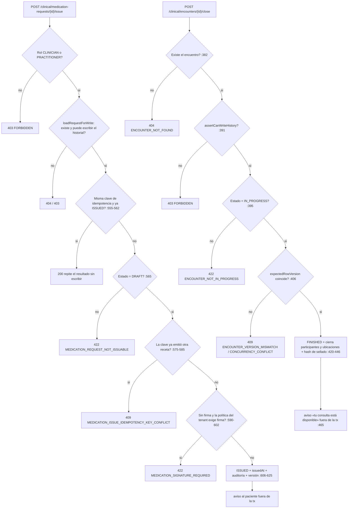

Notas: `POST /charts/notes` y `/clinical/encounters/{id}/close` exigen `CLINICIAN` o `PRACTITIONER` (inv.). La cadena exacta de decisiones de `createNote` solo se leyó hasta `assertEncounterBelongsToPatientAndWritable` (`chart-notes.service.ts:~97-105`); sus códigos de error: contrato 400, 401, 403, 404, 422, 429 (`inventario/endpoints/chart.json`). Receta: contrato 400, 401, 403, 404, 409, 422, 429 y **500 `INTERNAL`** (inv. `clinical.json`; el 500 declarado en `issue` y `prescribe` es un defecto del contrato a revisar, no se investigó la causa).

---

### F5 · F2 — Pedido de farmacia hasta la dispensación

**Datos**

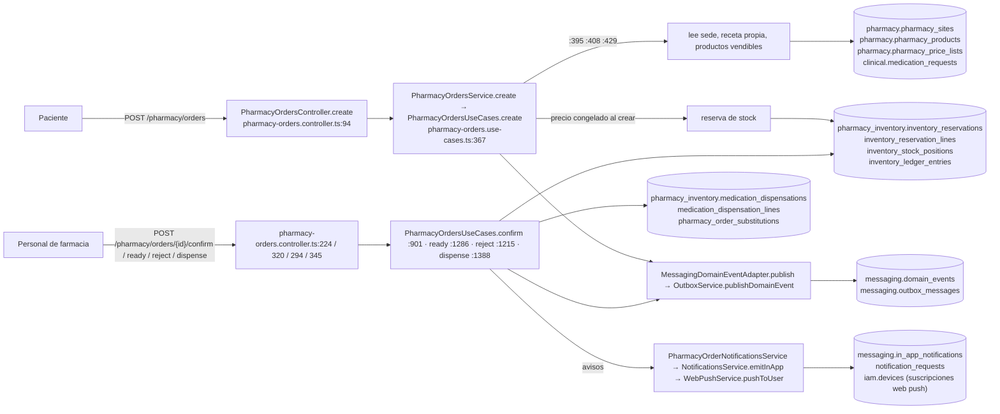

**Árbol de decisión (dispensar y transiciones)**

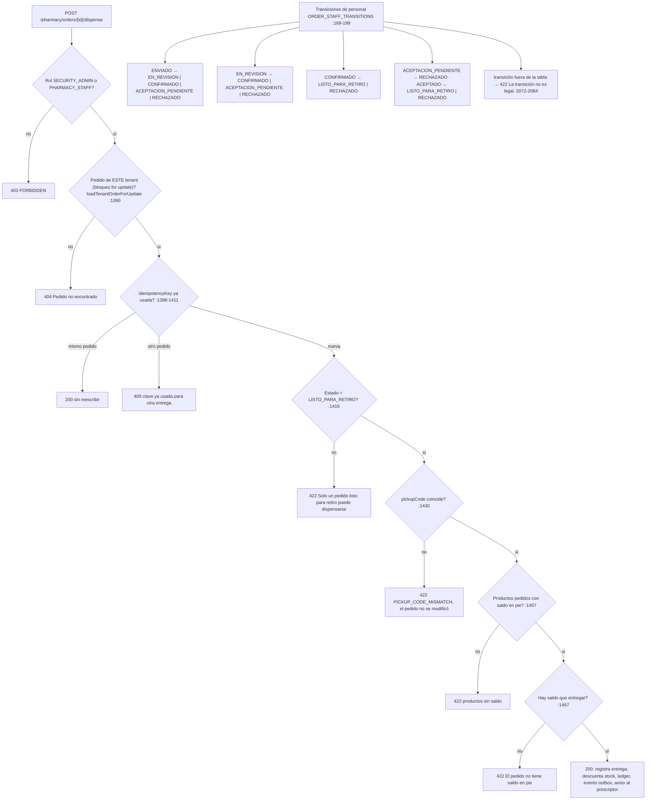

Notas: el código de retiro tiene 6 caracteres y alfabeto de 31 símbolos, unicidad por sede con índice parcial (`pharmacy-orders.use-cases.ts:95-130`). El estado `LISTO_PARA_RETIRO → ENTREGADO` no aparece en `ORDER_STAFF_TRANSITIONS`: la dispensación lo hace por otra vía (**no verificado** dónde se fija el estado final). `POST /pharmacy/{pharmacyId}/dispensations` (`pharmacy-dispensing.controller.ts:38`) es una segunda puerta de dispensación solo para `SECURITY_ADMIN`: dos caminos para el mismo hecho, a revisar.

---

### F6 · L1 — Laboratorio: de la orden clínica a la liberación del informe

**Datos**

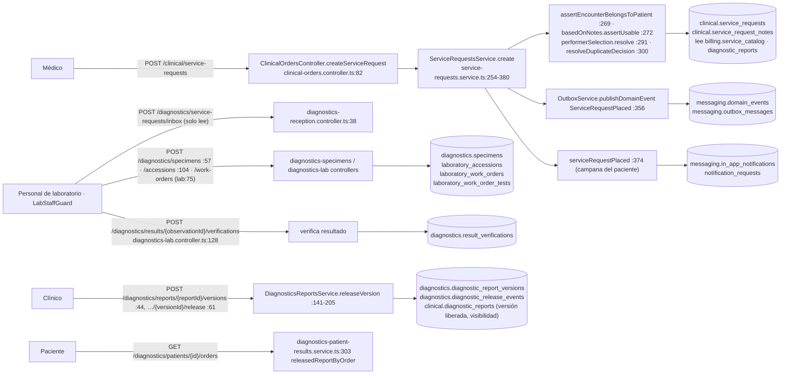

**Árbol de decisión (liberar versión del informe)**

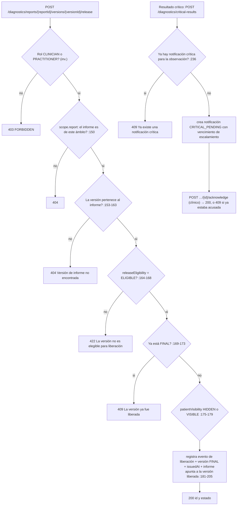

Notas: los controladores de recepción, muestras y laboratorio **no** tienen `@Roles` sino `@UseGuards(LabStaffGuard)` a nivel de clase (`diagnostics-specimens.controller.ts:46`, `diagnostics-lab.controller.ts:45`, `diagnostics-reception.controller.ts:23`; guard en `diagnostics/guards/lab-staff.guard.ts:63`). El árbol que sirve el portal para `POST /diagnostics/specimens` dice «Sin @Roles en el controlador (si hay regla de acceso, vive en el servicio)» (`inventario/arboles/diagnostics.json`): el árbol **no ve el guard**. La orden `ServiceRequestPlaced` y el aviso al paciente se emiten dentro de la transacción (`service-requests.service.ts:356-380`). Nota de contrato: `POST /diagnostics/service-requests/inbox` es `POST` pero no escribe (inv.: `ESCRIBE []`).

---

### F7 · B1 + B2 — Cobro de la consulta y pago por pasarela

**Datos**

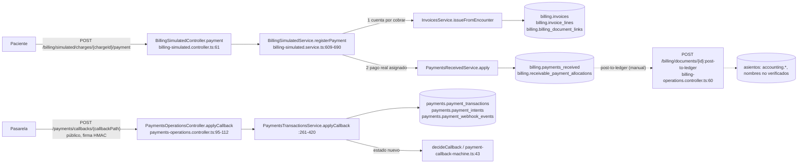

**Árbol de decisión (registrar pago y callback)**

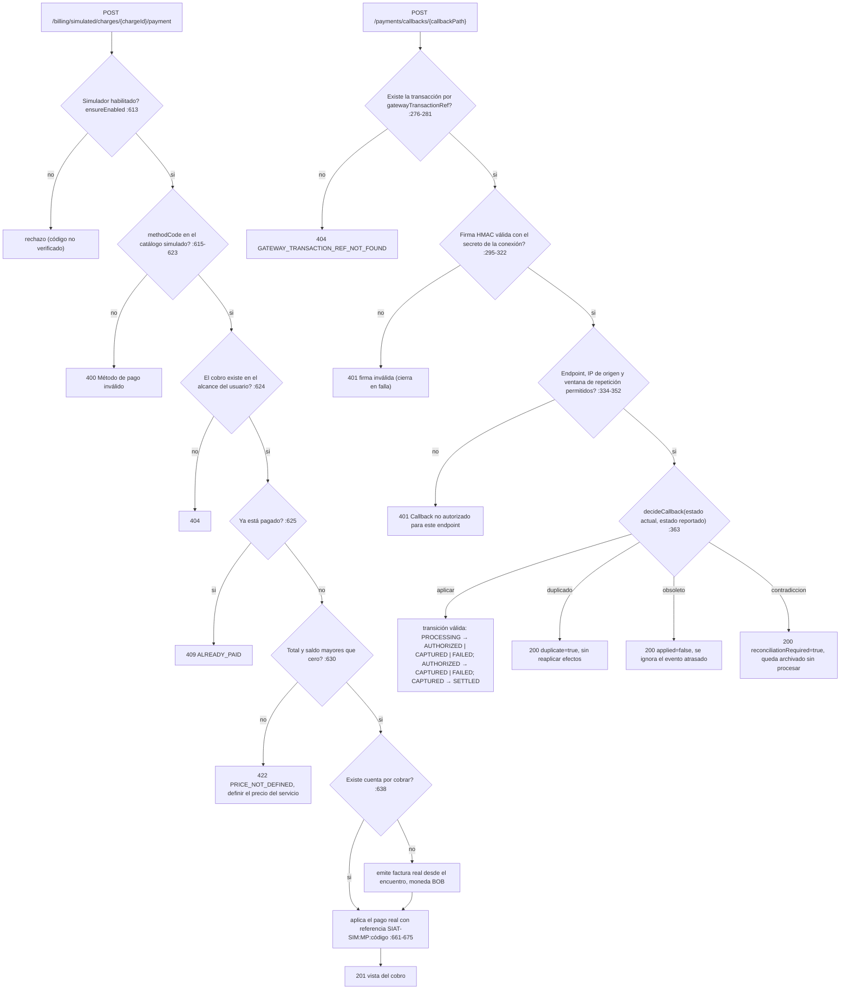

Notas: el cobro de la consulta **hoy es simulado**: ruta `/billing/simulated/*`, `ensureEnabled()` y referencia `SIAT-SIM`, pero escribe en tablas reales de facturación (comentario `billing-simulated.service.ts:660`: «El pago REAL, asignado a esa cuenta por cobrar»). El inbox del webhook archiva el hecho verificado antes de decidir (`payments-transactions.service.ts:372-390`). Máquina `payments.TRANSITIONS`: `payments/services/payment-callback-machine.ts:43` (6 estados, 6 transiciones, `maquinas.json`). La API no tiene un endpoint que ligue la pasarela con el cobro de la consulta: **no verificado** cómo se une `payments.payment_intents` con `billing.payments_received`.

---

### F8 · S1 — Seguros: reclamo (837) sobre un servicio

**Datos**

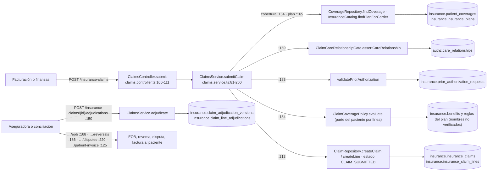

**Árbol de decisión (enviar el reclamo)**

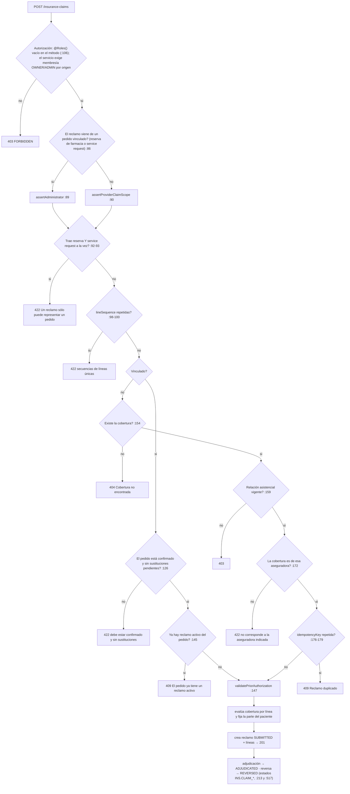

Notas: **no hay máquina de estados del reclamo en el inventario**: `insurance.TRANSITIONS` de `maquinas.json` es la de *campañas* (`DRAFT→ACTIVE→PAUSED/EXPIRED`, `insurance-campaigns.service.ts:124-131`), no la del reclamo; el árbol del reclamo se dedujo solo de `submitClaim` y de los usos de `INS.CLAIM_SUBMITTED/ADJUDICATED/REVERSED` (`claims.service.ts:213, 517-518`). Contrato de `POST /insurance-claims`: 201, 400, 401, 403, 404, 409, 422, 429. Discrepancia: el inventario muestra roles `BILLING, FINANCE` para esta ruta (`inventario/endpoints/insurance.json`) pero el método declara `@Roles()` vacío (`claims.controller.ts:106`); **no verificado** si un `@Roles()` vacío anula o hereda los de clase (`:59`).

---

### Extra · H4 + H5 — Consentimiento: solicitud de acceso del profesional y retiro

**Datos**

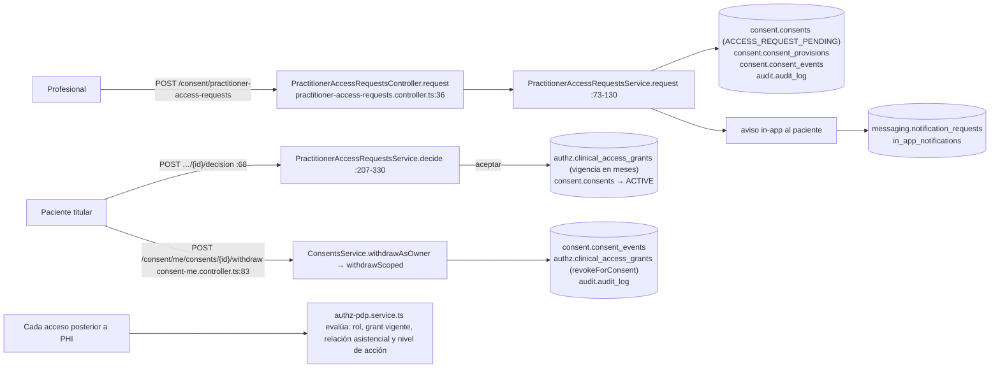

**Árbol de decisión (decisión del paciente)**

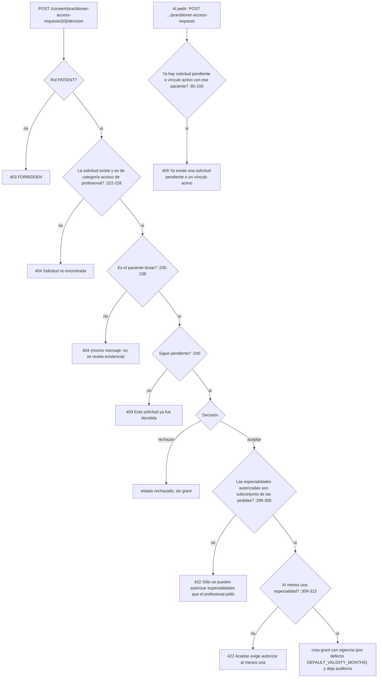

Notas: solo `PATIENT` decide (inv.); el rol del flujo crítico `critico:consent` dice «PATIENT (otorga/retira)» pero `POST /consent/consents` exige `SECURITY_ADMIN` (inv. `consent.json`): el camino real del paciente es `/consent/me/*` y `/decision`, no el flujo documentado (`docs/business/critical-workflows.md:84`, vía `procesos.json`).

---

## 4. Árbol del inventario: lo que ya pinta el front y lo que no

El front ya consume el inventario (74 procesos, 1 642 operaciones): `FRONT/src/app/core/data-access/admin-portal/portal.client.ts:40-108` (version, operaciones, árbol, procesos, grafo, mapa, hallazgos, tablas, deriva, linaje, glosario). Tipos del grafo: `NodoGrafo {id,tipo,etiqueta,operacionId?,riesgo?,etapa?}`, `AristaGrafo {de,a,tipo}` (`portal.types.ts:248-269`); del árbol: `NodoArbol {tipo, txt, corto, detalle, destino, tabla, operacion, confianza, excepcion, estado, codigo, mensaje, hijos, entonces, sino}` (`portal.types.ts:153-178`). Contadores sobre los JSON reales:

| Medida | Valor |
|---|---|
| Tipos de nodo en `inventario/grafos/*.json` | `TABLA` 3 229 · `OPERACION` 3 222 · `ETAPA` 758 · `ACTOR` 377 · `EVENTO` 86 · `DOMINIO` 17 · `TRABAJO` 2 |
| Tipos de arista | `LEE` 16 329 · `ESCRIBE` 5 858 · `REFERENCIA` 4 608 · `CONTIENE` 1 657 · `ACTUA` 1 657 · `PERTENECE` 1 230 · `PUBLICA` 107 · `BORRA` 106 · `SIGUE` 4 · `ENCOLA` 3 |
| Tipos de nodo en `inventario/arboles/*.json` | `ACCESO` 8 436 · `RESPUESTA` 1 627 · `LLAMADA` 1 618 · `SI` 28 · `INTENTAR` 1 · `TRABAJO` 1 |
| Operaciones con tablas / sin tablas / con eventos / con trabajos | 1 565 / 77 / 102 / 3 |
| Confianza de las 16 000+ relaciones operación→tabla | `DIRECTA` 9 175 · `POR_SQL` 1 173 · `POR_TIPO` 847 · `POR_REGISTRO` 84 |
| Ficha de operación: `tablas[].via` | Sí: cadena de llamadas controlador → servicio → repositorio (DTO `portal-response.dto.ts:103-108`; el front ya la muestra como texto «Vía A → B → C», `operation-data.html:24-25`) |

---

## 5. Qué hay que construir en el front para igualar el detalle de Atlas

Referencia Atlas: `Flow` trae `reads[]`, `writes[]`, `guards[]`, `roles[]`, `callers[]` y un `analysis {chainLength, services[], writes[{table,op,via}], errors[], blockCalls[{target,at}], unknowns[{reason,at}], transactional}` (`ATLAS/src/features/flows/types.ts:28-81`); su grafo tiene 13 tipos de nodo (`ACTOR, CLIENT, ENDPOINT, GUARD, CONTROLLER, HANDLER, SERVICE, REPOSITORY, DATABASE, ERROR, BLOCK_CALL, EVENT, UNKNOWN`) en 4 capas (`CLIENT, API, BACKEND, DATA`) y aristas con `confidence` y `evidence[]` (`types.ts:140-174`), dibujado con `@xyflow/react` + ELK en un Web Worker (`graph-layout.ts:1-84`) y un nodo `UNKNOWN` punteado «que es un hueco declarado» (`flow-node-card.tsx`). El front de AloVida **no tiene** librería de grafos (`package.json` sin `elkjs`, `@xyflow`, `mermaid`, `d3`, `dagre`); el diagrama de proceso es HTML/CSS por carriles (`process-diagram/process-graph.ts`, `process-graph.model.ts:1-60`). Agregar una librería requiere decisión registrada (regla 95.1.4 de la casa).

### 5.1 Lo que se puede hacer HOY solo en el front (sin tocar la API)

1. **Pestaña «Flujo de datos» en `flow-detail`** (`FRONT/src/app/features/admin/flows/flow-detail/flow-detail.ts`). Para cada nodo `API_CALL` con `endpoint.contract = DECLARED` y `operationId` (`flows.types.ts:117-122`), pedir `PortalClient.getOperation(operationId)` (`portal.client.ts:48`) y pintar carriles: pantalla (`uiRoute`) → endpoint → `codigo.controlador.handler` → `tablas[].via` (servicio/repositorio) → tablas por efecto (`ESCRIBE`/`BORRA`/`LEE`), más `eventos` y `trabajos`. Reusar `buildLanes`/`GraphLane` de `process-graph.model.ts` y los rótulos de `portal-labels.ts`. **Riesgo/hipótesis:** que el `operationId` que calcula `RouteIndexService` (`qa-flows.service.ts:113-126`) coincida con el `id` del inventario (`IamAuthController_login`); **no verificado**.
2. **Árbol de decisión enriquecido**: en `flow-tree` mostrar bajo cada nodo `API_CALL` las respuestas posibles de la operación (`respuestasPosibles`: estado + código + causas, `inventory.types.ts:46-50`) y el árbol de acceso/validación de `GET /admin/portal/operaciones/{id}/arbol` (nodos `ACCESO`/`LLAMADA`/`RESPUESTA` con `falla {estado,codigo}`), para que las ramas narrativas (`condition`/`expected`) queden contrastadas con los códigos reales del contrato.
3. **Estados de transición**: superponer `GET /admin/portal/flujos/{codigo}` → `maquinasDeEstado` (`portal.types.ts:244`; estados, transiciones, terminales; `ProcesoDetalle`) en los nodos que mutan estado (agenda, farmacia, pagos, contabilidad, defectos de QA). Hoy hay 12 máquinas en `maquinas.json`.
4. **Hueco declarado**: pintar los `gap` y `noResuelto` de la operación como recuadro punteado con su motivo (patrón Atlas), nunca como un hecho; y mostrar la `confianza` (`DIRECTA` / `POR_SQL` / `POR_TIPO` / `POR_REGISTRO`) como etiqueta por tabla, para no vender inferencia como certeza.
5. **Selector de flujos del catálogo + procesos del inventario** en una sola pantalla: hoy son dos mundos (`/superadmin/flows` vs `/superadmin/portal/processes`, `app.routes.ts:225,971`); ofrecer en el detalle del flujo un enlace «ver el mismo recorrido derivado del código» al proceso del inventario.
6. **Árbol y datos del diagrama de proceso** ya existentes (`process-diagram`, `decision-tree`) se enlazan desde cada nodo, con el mismo deep link `?open=` que usa Atlas (`flow-graph-page.tsx`).

### 5.2 Lo que FALTA en la API para pintar el árbol y el flujo de datos con el mismo detalle que Atlas

| # | Falta | Evidencia | Qué pedir |
|---|---|---|---|
| A1 | El catálogo QA no sabe de datos: `FlowNode` solo tiene `endpoint`, `gap`, `effects[]` de texto libre | `qa_lab/domain/flow-catalog.ts:68-82` | Que `GET /admin/qa/flows/:id` incluya por nodo `operationId` ya resuelto y un resumen `data {writes[], reads[], events[], jobs[]}` tomado del inventario (o que el front haga el join, 5.1.1). |
| A2 | El grafo del inventario **no tiene capas servicio/repositorio, guard, error ni cliente**: solo `ACTOR/ETAPA/OPERACION/TABLA/EVENTO/DOMINIO/TRABAJO` | conteo de §4; Atlas tiene `SERVICE, REPOSITORY, GUARD, ERROR, BLOCK_CALL, CLIENT` | Un `GET /admin/portal/operaciones/{id}/grafo` (cadena `via` convertida en nodos y aristas) o ampliar `inventario/grafos` con esos tipos. La cadena ya está en `tablas[].via`. |
| A3 | Las aristas no llevan `confidence` ni `evidence` | `AristaGrafo {de,a,tipo}` (`portal.types.ts:257-261`) vs Atlas `GraphEdge` (`types.ts:161-169`); la confianza sí existe en `tablas[].confianza` y la evidencia en `tablas[].fuente` (`inventory.types.ts:30-39`) | Copiar `confianza` y `fuente` a la arista `LEE/ESCRIBE/BORRA`. |
| A4 | **Los guards propios son invisibles**: la API solo reporta `@Roles`; 23 archivos de controlador usan `@UseGuards(...)` y su operación sale «sin roles» | `diagnostics-specimens.controller.ts:46` + `inventario/arboles/diagnostics.json` («Sin @Roles…, vive en el servicio»); `grep -rln "UseGuards(" --include=*.controller.ts src/modules` = 23 | Que el generador de inventario (`tools/inventario/endpoints.mjs`) añada `guards[]` a `autenticacion` y un nodo `ACCESO` por guard (Atlas expone `guards`, `types.ts:50`). |
| A5 | El inventario puede mentir sobre roles: `@Roles()` vacío no se distingue de «hereda los de clase» | `claims.controller.ts:106` vs `inventario/endpoints/insurance.json` (`BILLING,FINANCE`) | Decidir qué significa y marcarlo (`rolesDeMetodo` vs `rolesDeClase`). |
| A6 | Atribución errónea de máquinas de estado por colisión de nombre (`TRANSITIONS`): `payments.TRANSITIONS` lista `PATCH /insurance-campaigns/{id}/status` entre sus operaciones; `insurance.TRANSITIONS` es de campañas, no de reclamos | `inventario/flujos/maquinas.json` (leído por script); `insurance-campaigns.service.ts:124` | Calificar por archivo en el código de la máquina y modelar la del reclamo (hoy sin máquina). |
| A7 | No hay **quién llama** (pantalla/cliente → operación) en el inventario | `MapaFila.llamadaPor` existe (`inventory.types.ts:184`) pero solo con datos si el análisis del front se importó; Atlas guarda `callers[]` y `screens` | Importar las rutas del front (`uiRoute` de los flujos ya lo cubre en 3 flujos) o generar `frontRoutes` desde `app.routes.ts`. |
| A8 | El detalle del flujo no trae **errores del contrato por nodo** ni **hallazgos** del flujo | `qa-flows.service.ts:177-200` no incluye `respuestasPosibles`; el portal sí tiene `hallazgos` (`admin-portal.controller.ts:111-128`) | Cruzar por `operationId`. |
| A9 | **Eventos y outbox poco visibles**: solo 102 operaciones declaran `eventos` y 3 `trabajos`, aunque casi todo el dominio publica por outbox (p. ej. farmacia usa `MessagingDomainEventAdapter.publish`) | conteo de §4; `via` de `POST /pharmacy/orders` | Que el análisis siga `OutboxService.publishDomainEvent` y los llene en `eventos` con su consumidor (patrón Atlas `EVENT`). |
| A10 | No hay **versión/huella del flujo curado** ni «frescura»: `observedOn` por caso, pero no estado del flujo (`UNVERIFIED/VERIFIED/BROKEN`, `FRESH/STALE`) | Atlas `FLOW_VERIFICATIONS` y `FLOW_FRESHNESS` (`types.ts:11-12`) | Derivar de `qa.lastRun` + `drifted` + `observedOn` y exponerlo en `FlowSummary`. |
| A11 | Solo 3 de ~28 flujos de usuario están en el catálogo (§2); cada uno nuevo exige JSON + `observedOn` contra API real y registro en `domain/flows/index.ts` | `domain/flows/README.md:46-52` | Backlog priorizado: C2, F2, L1, S1, I1, I2, H4/H5, B2. |

### 5.3 Orden sugerido (dependencias, `NO_BIG_BANG_REWRITE`)

1. 5.1.1 + 5.1.4 (join por `operationId` y hueco declarado): no cambian contrato, solo front; verificar primero la hipótesis del `operationId`.
2. A1/A8 en la API (enriquecer `flows/:id`) y entonces 5.1.2–5.1.3.
3. A2–A4 (grafo con capas, confianza en aristas, guards) antes de cualquier diagrama «tipo Atlas»; sin A4 los árboles de laboratorio seguirán mostrando «sin roles».
4. Decidir la librería de render (ADR) solo si los carriles HTML no alcanzan para >60 nodos; los grafos de módulo llegan a 288 nodos (`systems-ops` en Atlas, comentario `graph-layout.ts`) y el de `scheduling` ya tiene 156 (`TABLA` 67 + `OPERACION` 66 + `ACTOR` 15 + `ETAPA` 8, `inventario/grafos/scheduling.json`).
5. Flujos nuevos al catálogo (A11) en paralelo, uno por PR, con los 3 niveles válido/límite/inválido (regla 65) y `observedOn` real.

## 6. No verificado / limitaciones

- No se ejecutó la API ni el front; ningún código de estado se observó en runtime (peldaño `DISCOVERED`). Los códigos HTTP salen de `respuestasPosibles` del inventario y de las excepciones leídas.
- Las cadenas `via` y las tablas son **análisis estático**: aparecen tablas dudosas (p. ej. `POST /scheduling/bookings/{id}/cancel` lista `community.conversation_participants`, que sí se explica por el chat al cancelar, pero `iam.devices` en `…/exceptions` es solo suscripción web push). La columna `confianza` debe leerse siempre.
- Las líneas «inv.» apuntan al primer decorador del handler y pueden diferir 1-3 líneas del `@Post`.
- El documento «Registro de procesos por módulo» de la bóveda no está en este workspace; los «Id propuestos» son deducidos del orden de secciones del documento del cliente.
- No se leyó: `BookingMaterializer` más allá de las líneas citadas, el repositorio de agenda (`SELECT ... FOR UPDATE` literal), `PharmacyOrdersUseCases.create` completo, `ChartNotesService.createNote` completo, `ClaimsService.adjudicate/dispute`, el módulo `promotions`, la integración real de la pasarela con la cuenta por cobrar.
- Los dos PRs por cambio (`dev` y `test`) no aplican: este archivo es de descubrimiento y no hay commit.
