# Descubrimiento 02 — Endpoints: agrupación, ciclo de la petición, tablas afectadas y brecha con Atlas

- Fecha: 2026-10-30 · Franja: descubrimiento (solo lectura; no se tocó código de ningún repo)
- Repos leídos: API `/home/user/mantra-core-health-api`, front `/home/user/mantra-core-health`, referencia `/home/user/pabloarauzcaballero/atlasadminportal`
- Peldaño de evidencia (regla 30): `DISCOVERED`. Todo lo de abajo cita `archivo:línea` o dice «no verificado». No se ejecutó la API, ni el front, ni `yarn inventario:verificar` (ver §5).
- Rutas relativas a la API salvo que se diga «front» o «Atlas».

## 0. Hallazgos principales (leer esto primero)

1. **La API ya calcula y sirve el mapa operación → tablas** para 1565 de 1627 operaciones (96,2 %), con confianza, camino handler→servicio→repositorio y `archivo:línea`. Se sirve en `GET /admin/portal/operaciones/:id` (campo `datos[]`) y en sentido inverso en `GET /admin/portal/linaje/tablas/:schema/:tabla`. No hace falta construir un derivador nuevo; hace falta **regenerarlo** (está desfasado) y **exponerlo mejor** (§3.3-3.4).
2. **El inventario está desfasado respecto del código**: 27 operaciones de 5 controladores existen en `src/` y no están en `openapi/openapi.json` ni en `inventario/` (§1.3). Última regeneración: commit `6ce6241c` del 2026-10-29 14:17; los controladores omitidos tienen commits posteriores (`a764377f`, 19:50).
3. **El «ciclo de vida de la petición» de Atlas no es una pestaña de la ficha del endpoint** (la ficha tiene 6 pestañas y ninguna es el ciclo, `Atlas src/features/systems-endpoints/endpoint-detail-page.tsx:31-38`). El equivalente de Atlas es el **diagrama por operación del módulo `flows`** (cliente → endpoint → guard → handler → servicio → repositorio → base, con nodos de error, evento y llamada bloqueante; `Atlas src/features/flows/types.ts:140-168`). Nuestra API ya trae un equivalente como **árbol de decisión** (`GET /admin/portal/operaciones/:id/arbol`) y el front lo pinta; lo que **no** hay es un diagrama por operación (solo por proceso).
4. **La medición por endpoint ya existe en otro módulo**: `GET /admin/ops/traffic/endpoints` devuelve, por plantilla de ruta, solicitudes, 2xx, 4xx, 5xx y latencia avg/p95/max, con `operationId` (`src/modules/ops_console/application/ops-traffic.service.ts:189-229`). Es la pieza para el eje «errores y latencia por funcionalidad» del plan; falta el cruce con el módulo/bloque del inventario (§3.4).
5. **`inventario/endpoints/admin-catalog.json` es un duplicado huérfano**: 15 operaciones sin `codigo`, sin tablas y fuera de `indice.json`, que ya cuentan bajo `data_catalog` (verificado: las 15 `(método, ruta)` están en el índice). Sumando todos los archivos por módulo da 1642 en lugar de 1627.

---

## 1. Cómo se agrupan los endpoints

### 1.1 Los ejes de agrupación que existen hoy

| Eje | De dónde sale | Dónde está | Cantidad |
|---|---|---|---|
| **Módulo** (carpeta de `src/modules/*`) | Directorio del controlador; es la unidad de los archivos `inventario/endpoints/<modulo>.json` y `docs/inventario/endpoints/<modulo>.md` | `inventario/endpoints/*.json`; índice `inventario/endpoints/indice.json` | 72 módulos, 1627 ops (`docs/inventario/endpoints/index.md:5`) |
| **Bloque** (dominio del modelo) | Nota del modelo `Mantra Core Health Context/docs/architecture/semantic-data-analysis.md:31` (campo `bloque.nombre` de cada operación) | Cada registro de `inventario/endpoints/*.json` | 12 valores (tabla de §1.4); 15 módulos quedan en «—» (sin bloque) |
| **Proceso** | README de cada módulo (tabla «UC → ruta») y `docs/business/critical-workflows.md` | `inventario/flujos/procesos.json`; `GET /admin/portal/flujos` | `AGRUPACION_POR_CONTROLADOR` cuando el README no asigna UC (`docs/inventario/README.md`, sección «Flujos: qué es cada cosa») |
| **Prefijo de ruta** (primer segmento) | Decorador `@Controller('…')` | Tabla de §1.4 | No coincide con el módulo: `cross_store_consistency` sirve `/admin` y `/workers`; `telemetry`, `/telemetry` y `/admin`; `data_catalog`, `/admin/portal`, `/admin/catalog` e `/internal/catalog` |

No hay `setGlobalPrefix` (grep en `src/`: sin resultados), de modo que la ruta real es la del decorador.

Atlas agrupa por `systemCode` (bloque de producto), `module` y `backendService` (`Atlas src/features/systems/types/catalog-types.ts:49-60`; filtro por bloque en `Atlas src/features/systems-endpoints/endpoints-page.tsx:62-70`). Nuestra API tiene un solo backend, así que `backendService` no aplica.

### 1.2 Cuenta verificada con grep y con el inventario

Método: recorrido de `src/**/*.ts` sin `*.spec.ts`, contando `^@Controller(` y `^\s*@(Get|Post|Put|Patch|Delete)\(`; y lectura de `inventario/endpoints/*.json`.

| Medida | Valor | Fuente |
|---|---|---|
| Decoradores `@Controller(` | 304 (en 303 archivos; 302 bajo `src/modules` más `src/app.controller.ts` y `src/persistence/health/data-sources.controller.ts`) | grep |
| Decoradores de verbo HTTP | 1637 | grep |
| Operaciones en el inventario | 1627 (1618 `CONTRATO` + 9 `CONTRATO_AUSENTE`) | `inventario/endpoints/indice.json` → `resumen`; `docs/inventario/endpoints/index.md:5` |
| Clases controlador distintas en el inventario | 299 | suma por módulo de `codigo.controlador` |
| Operaciones públicas / solo sesión (autenticadas sin `@Roles`) | 64 / 307 | cálculo sobre `autenticacion` de cada operación |
| Roles distintos que aparecen | 127. Los más usados (nº de rutas): `SECURITY_ADMIN` 460, `PRACTITIONER` 271, `PLATFORM_ADMIN` 271, `CLINICIAN` 198, `SYSTEM` 178 | idem |

### 1.3 Discrepancias entre el código y el inventario (1637 vs 1627)

| Diferencia | Causa verificada | Efecto |
|---|---|---|
| **−27 sin inventariar** | 5 controladores registrados en su módulo y con **0 apariciones en `openapi/openapi.json`**: `AdmissionsController` (14 ops, `src/modules/profiles/presentation/controllers/admissions.controller.ts:78`), `OwnAdmissionController` (3), `PharmacyBulkController` (4, `src/modules/pharmacy/controllers/pharmacy-bulk.controller.ts:40`), `PharmacyIntegrationSyncController` (5), `PharmacySiteAvailabilityController` (1). Registrados en `profiles.module.ts`, `pharmacy.module.ts`, `pharmacy_inventory.module.ts` | El portal no los muestra. Incluye la **carga masiva de farmacia** que el plan cita como patrón (H6) |
| **+17 en el inventario** | Rutas con más de una ruta por decorador o alias: `community` 104 vs 100, `insurance` 72 vs 64, `iam` 41 vs 40, `messaging` 21 vs 20, `promotions` 20 vs 19, `redis_runtime` 6 vs 5, `search_platform` 4 vs 3 (no se abrió cada alias: **motivo exacto no verificado**) | Neto: −27 + 17 = −10 |
| **Archivo huérfano** | `inventario/endpoints/admin-catalog.json` (15 ops, `codigo: null`, 0 tablas) | Duplica `data_catalog`; hallazgo 5 |

`yarn inventario:verificar` (`package.json:132`) es la señal oficial de desfase; **no se pudo ejecutar** (`ERR_MODULE_NOT_FOUND`: dependencias sin instalar en esta máquina). Lo anterior sale de grep y de `git log`, no de ese comando.

### 1.4 Tabla módulo → nº de endpoints → prefijos → roles que los leen

Columnas: **Ops** = operaciones del inventario; **Ctrl.** = clases controlador distintas; **GET**; **Prefijos** = primer segmento de ruta con su cuenta (4 primeros); **Roles que leen** = roles declarados en las rutas `GET` (4 más frecuentes, con nº de rutas; «—» = ninguna `GET` declara rol); **Públicas** = sin sesión; **Solo sesión** = autenticadas sin `@Roles`. Generada desde `inventario/endpoints/<modulo>.json` (excluido el huérfano `admin-catalog`).

| Módulo | Ops | Ctrl. | GET | Prefijos (nº) | Roles que leen (GET, nº de rutas) | Públicas | Solo sesión |
|---|---|---|---|---|---|---|---|
| `accounting` | 59 | 10 | 22 | `/accounting` 59 | PRACTITIONER 22, SECURITY_ADMIN 13, ACCOUNTING_APPROVER 13 | 0 | 0 |
| `ads` | 18 | 1 | 0 | `/ads` 18 | — | 0 | 0 |
| `app` | 6 | 2 | 6 | `/health` 3, `/` 1, `/liveness` 1, `/readiness` 1 | PLATFORM_ADMIN 2, SRE 2, SECURITY_ADMIN 2 | 3 | 1 |
| `audio_assets` | 10 | 2 | 2 | `/internal` 8, `/audio-assets` 2 | SYSTEM 1 | 0 | 2 |
| `audit` | 14 | 6 | 4 | `/audit` 10, `/privacy` 2, `/compliance` 1, `/moderation` 1 | SECURITY_ADMIN 3, AUDITOR 2, DPO 2, PATIENT 1 | 0 | 0 |
| `auth_providers` | 12 | 1 | 0 | `/auth-providers` 12 | — | 0 | 0 |
| `authz` | 32 | 9 | 9 | `/authz` 32 | SECURITY_ADMIN 7, PATIENT 2, CLINICIAN 1 | 0 | 0 |
| `automation` | 17 | 2 | 0 | `/automation` 17 | — | 0 | 0 |
| `billing` | 38 | 6 | 16 | `/billing` 37, `/patient-spending` 1 | SECURITY_ADMIN 3, PATIENT 1 | 0 | 18 |
| `chart` | 23 | 7 | 10 | `/charts` 23 | CLINICIAN 6, PRACTITIONER 6, SECURITY_ADMIN 2 | 0 | 4 |
| `clinical` | 42 | 11 | 10 | `/clinical` 41, `/public` 1 | CLINICIAN 7, PATIENT 7, PRACTITIONER 6, SECURITY_ADMIN 1 | 1 | 2 |
| `clinical_ext` | 32 | 8 | 7 | `/referrals` 9, `/care-teams` 3, `/cds-rules` 3, `/prescription-favorites` 3 (+8) | CLINICIAN 6, PRACTITIONER 6, PATIENT 1 | 0 | 3 |
| `common` | 19 | 6 | 3 | `/common` 13, `/internal` 6 | SYSTEM 1, SECURITY_ADMIN 1 | 0 | 9 |
| `community` | 104 | 14 | 58 | `/community` 69, `/public` 15, `/internal` 9, `/` 4 (+6) | SECURITY_ADMIN 6, SYSTEM 3, SEARCH_ADMIN 1, PATIENT 1 | 20 | 67 |
| `consent` | 27 | 11 | 8 | `/consent` 27 | PATIENT 5, CLINICIAN 3, PRACTITIONER 3 | 0 | 0 |
| `content_packs` | 2 | 1 | 1 | `/admin` 2 | SUPERADMIN 1 | 0 | 0 |
| `crm` | 16 | 1 | 1 | `/crm` 16 | CRM_ADMIN 1, CRM_AGENT 1 | 0 | 0 |
| `cross_store_consistency` | 16 | 2 | 2 | `/admin` 8, `/workers` 8 | SYSTEM 2, DELETION_WORKER 2, PLATFORM_ADMIN 2 | 0 | 0 |
| `data_catalog` | 38 | 4 | 29 | `/admin` 36, `/internal` 2 | SECURITY_ADMIN 29, PLATFORM_ADMIN 29, GOVERNANCE_ADMIN 29, DATA_PLATFORM_ADMIN 29 | 0 | 0 |
| `delegated_access` | 12 | 5 | 1 | `/practitioner-delegates` 4, `/delegated-permission-sets` 3, `/org` 2, `/access-requests` 1 (+2) | SECURITY_ADMIN 1 | 0 | 0 |
| `diagnostic_units` | 21 | 5 | 5 | `/diagnostic-units` 14, `/diagnostic-unit-sites` 2, `/diagnostic-equipment` 1, `/diagnostic-study-offerings` 1 (+3) | SECURITY_ADMIN 2 | 0 | 3 |
| `diagnostics` | 31 | 7 | 10 | `/diagnostics` 23, `/diagnostic-results` 7, `/dicomweb` 1 | PATIENT 5, CLINICIAN 2, PRACTITIONER 2 | 0 | 13 |
| `directory` | 26 | 3 | 11 | `/tenants` 21, `/admin` 5 | SUPERADMIN 1, SECURITY_ADMIN 1 | 0 | 20 |
| `document_store` | 5 | 1 | 2 | `/document-store` 5 | STORAGE_ADMIN 2, PLATFORM_ADMIN 2 | 0 | 0 |
| `education` | 14 | 1 | 0 | `/education` 14 | — | 0 | 0 |
| `erp` | 17 | 1 | 0 | `/erp` 17 | — | 0 | 0 |
| `forms` | 25 | 6 | 8 | `/forms` 25 | CLINICIAN 6, PRACTITIONER 6, SECURITY_ADMIN 4 | 0 | 2 |
| `geo` | 11 | 5 | 1 | `/geo` 10, `/public` 1 | SECURITY_ADMIN 1 | 1 | 0 |
| `graph_intelligence` | 15 | 2 | 0 | `/graph` 15 | — | 0 | 0 |
| `health_context` | 13 | 1 | 1 | `/health-context` 13 | CONTEXT_CONSUMER 1, CONTEXT_CURATOR 1, SYSTEM 1, PLATFORM_ADMIN 1 | 0 | 0 |
| `health_data` | 16 | 2 | 1 | `/health-data` 14, `/fhir` 2 | INTEROP_CONSUMER 1, CLINICAL_INFORMATICIAN 1, HEALTH_DATA_ADMIN 1 | 0 | 0 |
| `iam` | 41 | 4 | 9 | `/iam` 41 | SECURITY_ADMIN 7 | 16 | 8 |
| `identity_assurance` | 28 | 8 | 6 | `/identity` 23, `/internal` 5 | SECURITY_ADMIN 3, SYSTEM 1 | 0 | 7 |
| `insurance` | 72 | 19 | 32 | `/insurance` 18, `/insurance-claims` 9, `/insurance-campaigns` 8, `/insurance-brokers` 5 (+16) | BILLING 4, FINANCE 4, SECURITY_ADMIN 3, BILLING_OPERATOR 2 | 4 | 38 |
| `integration_contracts` | 12 | 2 | 0 | `/integration` 12 | — | 0 | 0 |
| `integrations` | 15 | 4 | 3 | `/integrations` 15 | SYSTEM 3, SECURITY_ADMIN 3 | 1 | 1 |
| `lakehouse` | 13 | 2 | 1 | `/lakehouse` 7, `/research` 6 | RESEARCH_GOVERNANCE 1, DPO 1, SYSTEM 1, PLATFORM_ADMIN 1 | 0 | 0 |
| `marketing` | 15 | 2 | 1 | `/marketing` 14, `/r` 1 | — | 1 | 0 |
| `medical_centers` | 2 | 1 | 2 | `/medical-centers` 2 | PATIENT 1 | 0 | 1 |
| `medical_groups` | 9 | 1 | 4 | `/medical-groups` 9 | PRACTITIONER 4, CLINICIAN 4 | 0 | 0 |
| `messaging` | 21 | 4 | 4 | `/notifications` 10, `/internal` 8, `/queues` 2, `/webhooks` 1 | MESSAGING_ADMIN 4, USER 3, SYSTEM 1 | 1 | 1 |
| `object_storage` | 14 | 2 | 2 | `/object-storage` 13, `/dicomweb` 1 | DICOM_VIEWER 2, CLINICIAN 2, STORAGE_ADMIN 2, SYSTEM 1 | 0 | 0 |
| `ops_console` | 9 | 1 | 9 | `/admin` 9 | PLATFORM_ADMIN 9, SRE 9, SECURITY_ADMIN 9, RELEASE_MANAGER 9 | 0 | 0 |
| `organization_extensions` | 9 | 4 | 0 | `/orgext` 9 | — | 0 | 0 |
| `payments` | 14 | 3 | 0 | `/payments` 14 | — | 1 | 0 |
| `pharma_lab` | 76 | 12 | 31 | `/pharma-labs` 47, `/visit-requests` 10, `/visit-surveys` 7, `/visit-agenda` 6 (+1) | PHARMA_LAB_ADMIN 21, PLATFORM_ADMIN 20, BUSINESS_ADMIN 8, PRACTITIONER 8 | 0 | 3 |
| `pharmacy` | 33 | 3 | 14 | `/pharmacies` 21, `/pharmacy` 9, `/public` 3 | SECURITY_ADMIN 2, PHARMACY_STAFF 2 | 3 | 9 |
| `pharmacy_inventory` | 30 | 6 | 5 | `/pharmacy` 25, `/internal` 3, `/pharmacy-inventory` 2 | SECURITY_ADMIN 1, PHARMACY_STAFF 1, PATIENT 1 | 0 | 4 |
| `platform_ops` | 15 | 1 | 0 | `/ops` 15 | — | 0 | 0 |
| `polyglot_storage` | 15 | 3 | 0 | `/governance` 11, `/ops` 3, `/finops` 1 | — | 0 | 0 |
| `practice` | 37 | 9 | 8 | `/practices` 16, `/practitioners` 10, `/role-assignments` 5, `/sites` 3 (+3) | SECURITY_ADMIN 3, SCHEDULING_ADMIN 3, PRACTITIONER 3, PERIOP_ADMIN 2 | 0 | 10 |
| `procedures_perioperative` | 32 | 2 | 5 | `/procedure-cases` 27, `/dental-procedures` 3, `/pacu-stays` 2 | SURGEON 3, ANESTHESIOLOGIST 3, PERIOP_NURSE 3, SURGERY_SCHEDULER 3 | 0 | 0 |
| `profiles` | 67 | 7 | 21 | `/profiles` 63, `/tenants` 4 | SECURITY_ADMIN 4, CLINICIAN 2, PRACTITIONER 2, SUPERADMIN 1 | 0 | 52 |
| `promotions` | 20 | 2 | 4 | `/loyalty` 10, `/promotions` 3, `/redemptions` 2, `/` 1 (+4) | PATIENT 3, SYSTEM 1, PROMOTIONS_ADMIN 1, MARKETING_MANAGER 1 | 0 | 1 |
| `public` | 4 | 1 | 3 | `/public` 4 | — | 4 | 0 |
| `qa_execution` | 9 | 2 | 3 | `/admin` 8, `/internal` 1 | QA_ADMIN 3, QA_ENGINEER 3, RELEASE_MANAGER 3, PLATFORM_ADMIN 3 | 0 | 0 |
| `qa_lab` | 21 | 3 | 8 | `/qa` 12, `/admin` 8, `/internal` 1 | QA_ADMIN 8, QA_ENGINEER 8, RELEASE_MANAGER 8, PLATFORM_ADMIN 8 | 0 | 0 |
| `quotations` | 3 | 1 | 2 | `/quotations` 3 | — | 0 | 2 |
| `read_models` | 15 | 3 | 5 | `/read-models` 9, `/portals` 3, `/public` 2, `/views` 1 | SYSTEM 1, SECURITY_ADMIN 1 | 2 | 3 |
| `redis_runtime` | 6 | 1 | 1 | `/redis-runtime` 6 | PLATFORM_OPERATOR 1 | 0 | 1 |
| `reporting` | 12 | 1 | 0 | `/reporting` 12 | — | 0 | 0 |
| `scheduling` | 66 | 8 | 21 | `/scheduling` 65, `/tenants` 1 | SCHEDULING_ADMIN 19, PRACTITIONER 18, SCHEDULING_AGENT 15, PATIENT 12 | 0 | 1 |
| `search_platform` | 4 | 1 | 0 | `/search` 4 | — | 0 | 1 |
| `surveys` | 18 | 4 | 6 | `/surveys` 18 | PRACTITIONER 4, CLINICIAN 4 | 0 | 3 |
| `system_context` | 13 | 1 | 2 | `/system-context` 13 | — | 1 | 1 |
| `system_ops` | 24 | 8 | 0 | `/admin` 22, `/internal` 2 | — | 0 | 0 |
| `telemetry` | 25 | 5 | 11 | `/telemetry` 15, `/admin` 10 | PLATFORM_ADMIN 10, SECURITY_ADMIN 10, DPO 10, DATA_PLATFORM_ADMIN 8 | 1 | 9 |
| `terminology` | 25 | 7 | 12 | `/terminology` 25 | SECURITY_ADMIN 3 | 3 | 7 |
| `time_series` | 14 | 2 | 1 | `/ts` 14 | ANALYST 1, DATA_PLATFORM_ADMIN 1, SYSTEM 1, PLATFORM_ADMIN 1 | 0 | 0 |
| `tracking` | 11 | 1 | 0 | `/tracking` 11 | — | 1 | 0 |
| `vector_rag` | 16 | 2 | 1 | `/vector-rag` 16 | SYSTEM 1, EMBEDDING_WORKER 1, PLATFORM_ADMIN 1 | 0 | 0 |
| `workflow` | 11 | 3 | 1 | `/workflow` 11 | AUDITOR 1, COMPLIANCE_OFFICER 1, CLINICIAN 1, PLATFORM_ADMIN 1 | 0 | 0 |
| **Total** | **1627** | **299** | | | | 64 | 307 |

Agrupado por **bloque** del modelo (útil para el selector de funcionalidad del tablero):

| Bloque (modelo) | Ops | Módulos |
|---|---|---|
| Clínico y Diagnóstico | 227 | 8 |
| — | 201 | 15 |
| Financiero y ERP | 200 | 5 |
| Marketing y Crecimiento | 187 | 6 |
| Núcleo y Terminología | 174 | 7 |
| Identidad y Seguridad | 152 | 6 |
| Datos y NoSQL | 119 | 8 |
| Práctica y Agenda | 112 | 3 |
| Operaciones de Plataforma | 92 | 5 |
| Farmacia | 63 | 2 |
| Integraciones y Contratos | 59 | 4 |
| Auditoría y Reporting | 41 | 3 |

Lectura para el plan: los módulos que concentran lo administrable con `PLATFORM_ADMIN`/`SECURITY_ADMIN` son `platform_ops`, `ops_console`, `telemetry` (parte `admin`), `data_catalog`, `system_ops`, `audit`, `authz`, `iam`, `qa_lab`, `qa_execution`, `lakehouse`, `graph_intelligence`, `cross_store_consistency`, `vector_rag`, `time_series`, `workflow` (columna «Roles que leen» de la tabla). Los roles del portal de inventario son siete: `SECURITY_ADMIN`, `PLATFORM_ADMIN`, `GOVERNANCE_ADMIN`, `DATA_PLATFORM_ADMIN`, `DPO`, `AUDITOR`, `DATA_STEWARD` (`src/modules/data_catalog/data_catalog.constants.ts:8-16`); `SUPERADMIN` de plataforma pasa por comodín en `RolesGuard` (`src/common/auth/roles.guard.ts:86`).

---

## 2. El ciclo de una petición en esta API (verificado en código)

Orden de Nest: middleware Express → guards → interceptores (entrada) → pipes → handler → interceptores (salida) → filtros de excepción. Lo global se registra en `src/main.ts` (middleware y pipe) y en `src/app.module.ts` / `src/common/auth/auth.module.ts` (guards, interceptores, filtro).

```mermaid
sequenceDiagram
    autonumber
    participant C as Cliente
    participant M as Middleware Express
    participant G as Guards globales
    participant I as Interceptores globales
    participant P as ValidationPipe global
    participant H as Controller
    participant S as Service
    participant R as Repositorio y ORM
    participant DB as PostgreSQL
    participant F as AllExceptionsFilter

    C->>M: HTTP request
    Note over M: helmet - src/main.ts:162<br/>medicion SLI si esta habilitada - src/main.ts:169-171 y http-sli.middleware.ts:52<br/>json y urlencoded 1 MB - src/main.ts:176-177<br/>CORS deny-by-default - src/main.ts:184<br/>pino-http con genReqId y cabecera X-Request-Id - src/logging/pino-options.ts:85-91 (modulo en app.module.ts:158)
    M->>G: pasa la peticion
    Note over G: 1 AuthThrottlerGuard 300 por 60 s - app.module.ts:147-148 y 270, common/security/auth-throttler.guard.ts:49,55<br/>2 JwtAuthGuard salta las rutas Public - common/auth/auth.module.ts:39, jwt-auth.guard.ts:28, jwt.strategy.ts:55-63<br/>3 TenantScopeGuard salta TenantAgnostic - auth.module.ts:42, tenant-scope.guard.ts:31,46,62<br/>4 RolesGuard con SUPERADMIN comodin - auth.module.ts:43, roles.guard.ts:59,72,86,94-97<br/>5 VerifiedIdentityGuard - auth.module.ts:44, verified-identity.guard.ts:52
    G-->>F: rechazo 401, 403 o 429 (no llega a los interceptores)
    G->>I: autorizado
    Note over I: a PublicCacheInterceptor solo rutas Public - app.module.ts:277, public-cache.interceptor.ts:87<br/>b TenantContextInterceptor valida el tenant y con RLS_ENFORCE abre transaccion y fija app.current_tenant_id - app.module.ts:280, tenant-context.interceptor.ts:80,147-168<br/>c AuditTrailInterceptor sella POST PUT PATCH DELETE - app.module.ts:286, audit-trail.interceptor.ts:38,171,244,266<br/>d TraceResponseInterceptor cabecera x-trace-id - app.module.ts:289, observability/trace-response.interceptor.ts:40
    I->>P: valida y transforma el DTO
    Note over P: whitelist, forbidNonWhitelisted y transform - common/http/validation-pipe.ts:114-122 (registro en main.ts:201)
    P-->>F: 400 VALIDATION_FAILED con details.fields
    P->>H: DTO valido
    Note over H: Roles, Audited y HttpCode en el handler - ej. modules/billing/controllers/billing-payables.controller.ts:37-52
    H->>S: llama al caso de uso
    S->>R: em.transactional - ej. billing/services/bills.service.ts:99-100
    R->>DB: INSERT y SELECT por MikroORM - ej. billing/repositories/bills.repository.ts:177
    S->>R: outbox.publishDomainEvent en la misma transaccion - messaging/services/outbox.service.ts:185,225,255,282
    R-->>S: commit
    S-->>H: DTO de respuesta, nunca el modelo ORM
    H-->>I: valor devuelto
    Note over I: salida en orden inverso - sello de exito en audit_log (audit-trail.interceptor.ts:244) y cierre de la transaccion RLS
    S-->>F: excepcion de dominio 404, 409 o 422
    Note over F: catch en common/filters/all-exceptions.filter.ts:191, correlationId igual a req.id de pino :217, sello de fallo audit-trail.interceptor.ts:266
    I-->>C: respuesta
    F-->>C: cuerpo de error code, message, correlationId, details
    Note over M,C: al terminar la respuesta (evento finish) el SLI anota verbo, plantilla de ruta, estado y duracion - http-sli.middleware.ts:66-68
```

### 2.1 Etapa → archivo:línea

| # | Etapa | Qué hace | Archivo:línea |
|---|---|---|---|
| 1 | Cabeceras de seguridad | `helmet()` | `src/main.ts:162` |
| 2 | Medición HTTP (SLI) | Middleware **antes** de los parsers para contar también los 4xx previos al handler; solo registra verbo, plantilla de ruta, estado y duración, nunca URL ni usuario | `src/main.ts:164-171`; `src/observability/http-sli/http-sli.middleware.ts:52,66-68` |
| 3 | Cuerpo | `json`/`urlencoded` con tope 1 MB | `src/main.ts:176-177` |
| 4 | CORS | Deny-by-default con lista de orígenes | `src/main.ts:182-184` |
| 5 | Id de petición | `genReqId` toma `x-request-id` del cliente **solo** si `TRUST_PROXY_HOPS>0`; si no, UUID; lo devuelve en `X-Request-Id` | `src/logging/pino-options.ts:85-91` |
| 6 | Limitación de tasa | 300 / 60 s global; el tracker se afina en login y refresh | `src/app.module.ts:147-148,270`; `src/common/security/auth-throttler.guard.ts:49,55` |
| 7 | Autenticación | JWT por Passport; `@Public()` se salta; `validate` exige `typ === 'access'` y sesión activa | `src/common/auth/auth.module.ts:39`; `jwt-auth.guard.ts:28-36`; `jwt.strategy.ts:55-63` |
| 8 | Tenant (guard) | Resuelve `request.resolvedTenantId` (cabecera `X-Tenant-Id` o membresía única); `@TenantAgnostic` lo omite | `src/common/auth/tenant-scope.guard.ts:31,46,62` |
| 9 | Roles | `@Roles(...)`; `SUPERADMIN` de plataforma pasa; si no, 403 `ROLE_INSUFFICIENT` | `src/common/auth/roles.guard.ts:59,72,86,94-97` |
| 10 | Identidad verificada | Solo actúa si el handler declara `@RequiresVerifiedIdentity` | `src/common/auth/verified-identity.guard.ts:52` |
| 11 | Caché pública | Solo `@Public()`; garantiza que una respuesta con sesión no sea `Cache-Control: public` | `src/common/http/public-cache.interceptor.ts:87` |
| 12 | Contexto de tenant / RLS | Compara ruta, cuerpo y query con el tenant; con `RLS_ENFORCE=true` abre `em.transactional` y ejecuta `set_config('app.current_tenant_id', …)` | `src/common/tenant/tenant-context.interceptor.ts:80,147-168` |
| 13 | Bitácora | Sella `audit.audit_log` (cadena WORM) en toda mutación autenticada salvo `@NotAudited`; registra lecturas solo con `@AccessLogged` | `src/modules/audit/interceptors/audit-trail.interceptor.ts:38,84,171,244,266` |
| 14 | Traza | Pone `x-trace-id` en la respuesta | `src/observability/trace-response.interceptor.ts:40-47` |
| 15 | Validación | `ValidationPipe` global; `exceptionFactory` agrega `details.fields` | `src/common/http/validation-pipe.ts:114-122`; `src/main.ts:201` |
| 16 | Controlador | Decoradores `@Roles`, `@Audited`, `@HttpCode`; delega al servicio | ej. `src/modules/billing/controllers/billing-payables.controller.ts:37-52` |
| 17 | Servicio + transacción | `this.em.transactional(async (tx) => …)`; `activeTenantId()` para el tenant | ej. `src/modules/billing/services/bills.service.ts:99-100` |
| 18 | Repositorio / ORM | `em.create(...)` recibe el `tx` | ej. `src/modules/billing/repositories/bills.repository.ts:177,208-209` |
| 19 | Evento (outbox) | `publishDomainEvent(tx, …)` escribe `domain_events` y `outbox_messages` en la misma transacción, con clave de idempotencia | `src/modules/messaging/services/outbox.service.ts:185,225,242,255,282` |
| 20 | Entrega asíncrona | El worker llama a `/internal/outbox/relay/run`; `claimPendingOutbox` y despacho a suscriptores | `src/worker/jobs/messaging/outbox-relay.job.ts:41,54`; `outbox.service.ts:316,472` |
| 21 | Filtro de errores | `AllExceptionsFilter` es `APP_FILTER`; oculta detalle de 5xx y añade `correlationId`; aplica también `x-trace-id` a los fallos previos a los interceptores | `src/app.module.ts:268`; `src/common/filters/all-exceptions.filter.ts:170,191,217` |

### 2.2 Lo que el inventario ya describe de este ciclo y lo que no

- El árbol de decisión por operación ya representa las etapas 6-9 y 15 como nodos `ACCESO` con su `falla {estado, codigo}` y su `f` (archivo:línea). Ejemplo: operación `ChartCarePlansController_createCarePlan` en `inventario/arboles/chart.json`. Distribución de nodos en los 1642 árboles: `LLAMADA` 12070, `EFECTO` 9509, `ACCESO` 8436, `SI` 5948, `ERROR` 4787, `RESPUESTA` 1627, `TRANSACCION` 1236, `BUCLE` 631, `INTENTAR` 272, `EVENTO` 96, `SEGUN` 11, `TRABAJO` 1.
- Los `requerimientos` globales cubren 6 tipos: autenticación, rol, tenant, cuerpo, validación y rate limit (+ parámetros de ruta/query y cabeceras). **No describen** la bitácora (etapa 13), la caché pública (11), la transacción RLS (12), la traza (14) ni el id de petición (5). El portal podría mostrar eso como «lo que hace el sistema antes y después de tu handler».
- **Citas desfasadas en el propio inventario**: el requerimiento `TENANT` cita `src/app.module.ts:276` (hoy es `PublicCacheStore,`; el interceptor de tenant está en `:280`) y `RATE_LIMIT` cita `:143` (hoy `ThrottlerModule.forRoot` está en `:147`). Prueba de que `inventario/` está por detrás del código (corrimiento de cuatro líneas en `app.module.ts`).

### 2.3 No verificado en esta etapa

- **Orden relativo** entre `AuthThrottlerGuard` (`app.module.ts:270`) y los cuatro guards de `AuthModule` (`auth.module.ts:39-44`): Nest respeta el orden de declaración *dentro* de un módulo (lo dice el comentario `auth.module.ts:15-20`), pero el orden *entre* módulos depende del recorrido del contenedor. El diagrama los numera 1-5 por convención; no se comprobó en ejecución.
- **Orden de `pino-http` frente a los `app.use` de `main.ts`**: `nestjs-pino` instala su middleware al inicializar el módulo (`app.module.ts:158`, `src/logging/logging.module.ts:21`); por razonamiento ocurriría después de los `app.use` de `main.ts`. No verificado.
- **Si `em.transactional` del servicio se une a la transacción RLS** que abre `TenantContextInterceptor` (`tenant-context.interceptor.ts:159`): no se leyó el comportamiento del ORM.
- Que el SLI esté habilitado en cada entorno: depende de `loadHttpSliEnv().enabled` (`src/main.ts:169`); no se leyó su valor por defecto.

---

## 3. Tablas afectadas por endpoint

### 3.1 Qué existe en la API (contrato real)

**Fuente de datos**: archivos JSON que genera `tools/inventario/*.mjs` y que se copian a la imagen (`Dockerfile:73`); `InventoryRepository` los lee de `process.cwd()/inventario` (o `INVENTARIO_DIR`) bajo demanda y responde **503** si faltan (`src/modules/data_catalog/infrastructure/repositories/inventory.repository.ts:38,69`). No consulta la base de datos (`src/modules/data_catalog/application/portal-inventory.service.ts:49-50`).

**Rutas** (controlador `admin/portal`; roles = los 7 de `PORTAL_READ_ROLES`; `@TenantAgnostic`; `src/modules/data_catalog/presentation/controllers/admin-portal.controller.ts:56-58`):

| Ruta | Línea | Devuelve | Relevante para «tablas afectadas» |
|---|---|---|---|
| `GET /admin/portal/version` | `:64` | `hash`, nº de operaciones, procesos, tablas, columnas, `origen` | Huella para detectar desfase (no trae fecha ni commit) |
| `GET /admin/portal/operaciones` | `:71` | Página de `OperacionResumenDto`: `id, metodo, ruta, modulo, nombre, origen, riesgo, publica, roles, tablas (número), flujos, senales` | Filtros: `q, modulo, riesgo, metodo, origen, senal, flujo` (`portal-query.dto.ts:52-110`) |
| `GET /admin/portal/operaciones/:id` | `:78` | `OperacionDetalleDto` con **`datos[]`** | **El mapa endpoint → tablas** |
| `GET /admin/portal/operaciones/:id/arbol` | `:92` | `nodos[]`, `respuestas[]`, `truncado` | Ciclo y decisiones |
| `GET /admin/portal/flujos/mapa` | `:104` | `MapaFilaDto`: ruta, procesos, riesgo, autorización, `llamadaPor` (clientes del front), `senales` | Vista de rutas |
| `GET /admin/portal/catalogo/tablas` y `/:schema/:tabla` | `:159,166` | Resumen y ficha de tabla (columnas, relaciones, índices, `operaciones` que la tocan) | Sentido inverso |
| `GET /admin/portal/linaje` y `/linaje/tablas/:schema/:tabla` | `:184,191` | Métricas globales; operaciones que leen/escriben una tabla; tablas referenciadas y referenciadoras | Sentido inverso |
| `GET /admin/portal/catalogo/deriva` | `:175` | Entidades sin tabla, tablas sin entidad, columnas ausentes, nulabilidad | Calidad del propio mapa |

**Campos de cada fila de `datos[]`** (`TablaOperacionDto`, `src/modules/data_catalog/presentation/dto/portal-response.dto.ts:96-115`; mapeo en `portal-inventory.service.ts:151-160`):

| Campo | Valores | Observación |
|---|---|---|
| `schema`, `tabla` | texto | Una operación puede repetir la misma tabla: una fila por (tabla, operación). Ej. `billing.bills` sale como `ESCRIBE/CREA` y como `LEE` en `POST /billing/bills` (`inventario/endpoints/billing.json`) |
| `operacion` | `LEE`, `ESCRIBE`, `BORRA` | |
| `detalle` | `CREA`, `ACTUALIZA`, `GUARDA`, `BORRA`, `LEE` | |
| `confianza` | `DIRECTA`, `POR_TIPO`, `POR_REGISTRO`, `POR_SQL` | Definidas en `docs/inventario/README.md:26-40`. Reparto en las 11 279 filas: DIRECTA 9175, POR_SQL 1173, POR_TIPO 847, POR_REGISTRO 84 |
| `via` | `[controlador.handler, Servicio.método, Repositorio.método]` | Camino de llamadas |
| `fuente` | `archivo:línea` | Dónde está el acceso |
| `catalogada` | bool | `false` si es vista u objeto fuera del catálogo; solo 2 de 11 279 filas |

Además, en el mismo detalle: `eventos[]` (solo el tipo; el JSON trae también `fuente` y `via`, que el servicio descarta, `portal-inventory.service.ts:161`), `trabajos[]` (`:162`), `noResuelto[]`, `sinTablas` (motivo) y `pruebas[]`. El número `tablas` del resumen es `o.tablas.length` (`portal-inventory.service.ts:80`), o sea cuenta **filas** (tabla × operación), no tablas distintas.

**Cobertura medida** (sobre `inventario/endpoints/*.json`, excluido el huérfano):

| Medida | Valor |
|---|---|
| Operaciones con al menos una tabla | 1565 de 1627 |
| Sin tablas | 62: 61 con motivo (Redis 5, MongoDB 5, OpenSearch 3, «el handler no invoca ningún servicio» 4, más curadas a mano en `tools/inventario/curado/sin-tablas.json`) y 1 sin determinar (`inventario/endpoints/indice.json` → `resumen.sinTablasSinDeterminar: 1`) |
| Tablas distintas tocadas | 990 |
| Operaciones con llamadas sin resolver (`noResuelto`) | 1 |
| Operaciones con `cierreParcial` | 34 |
| Operaciones que emiten evento / encolan trabajo | 102 / 3 |

**Tablas de BD paralelas, sin lectura**: existen `data_catalog.catalog_operations` y `catalog_operation_impacts` (`src/modules/data_catalog/entities/catalog_operation_impacts.entity.ts:4`), llenadas por `POST /internal/catalog/inventory/import` (rol `SYSTEM`, idempotente; `presentation/controllers/internal-catalog.controller.ts`; `infrastructure/repositories/catalog-inventory.repository.ts:229-244`). **Ningún endpoint de lectura las consulta** (grep: solo la entidad, el repositorio de importación y el controlador interno). `GET /admin/catalog/objects/:id/impact` NO es esto: devuelve claves foráneas observadas, no operaciones (`presentation/controllers/admin-catalog.controller.ts:213-223`).

### 3.2 Cómo se obtiene y hasta dónde es fiable

- Análisis estático del AST de TypeScript: handler → servicio → repositorio → entidad → tabla (`tools/inventario/lib/datos.mjs:1-14`, `crearAnalizadorDeDatos` en `:122`). Sigue puertos hasta sus implementaciones y une los efectos si hay varias (`docs/inventario/README.md`, sección «Cómo se deduce qué tablas toca una operación»).
- Lo que depende de datos en tiempo de ejecución se declara `noResuelto`; no inventa tablas.
- Límites declarados por el propio inventario (`docs/inventario/README.md`, sección «Lo que el inventario NO afirma»): `POR_TIPO` supone un `flush` en la misma unidad de trabajo (cotejado a mano en 10 operaciones, no en todas); «pruebas» es búsqueda textual, no cobertura; `datosPersonales` es siempre `SIN_FUENTE`.

### 3.3 Qué falta para que sea fiable de verdad (por orden de valor)

1. **Regenerar y gatear**: `yarn inventario:endpoints`, `inventario:flujos`, `inventario:catalogo` y `inventario:verificar` (necesita `../mantra-core-health-model` como hermano —existe en esta máquina— o `MODEL_ROOT`, y dependencias instaladas). Hoy faltan 27 operaciones y hay citas corridas (§1.3, §2.2). Como el CI propio está caído (CLAUDE.md del front, sección Git), el gate debe correrse a mano y pegarse la salida.
2. **Retirar o regenerar `admin-catalog.json`** para que la suma por módulo cuadre con el índice.
3. **Dedup por tabla** en el contrato (una fila por tabla con `lee`, `escribe` y la confianza mínima), porque hoy el cliente recibe la misma tabla repetida y el número `tablas` del resumen infla.
4. **Exponer lo que el JSON ya tiene y el DTO descarta**: `fuente` y `via` de `eventos[]`/`trabajos[]`; `cierreParcial` (34 ops); `casosDeUso` (UC-xx del README); `codigo.controlador` y `codigo.handler`.
5. **Validación cruzada en ejecución** (no existe): comparar las tablas inferidas con las consultas reales de una corrida de integración. Es una propuesta de diseño; **no verificado** que MikroORM ofrezca el gancho (hay que leer `src/orm/config/orm.config.ts`).
6. **Alternativas de derivación evaluadas**: (a) decorador explícito `@Touches(...)` por handler: fiable pero son 1627 anotaciones a mano que se desfasan; (b) entidades de los repositorios inyectados: es lo que ya hace el analizador (`via`); (c) análisis de SQL literal: ya cubre `POR_SQL` (1173 filas); (d) trazas de ejecución: la API ya emite spans (`ObservabilityModule`, `app.module.ts:162`), pero no se verificó que un span lleve el nombre de la tabla.

### 3.4 Qué se puede construir sin tocar la API

- La pestaña «Datos» del front ya existe (§4). Falta ordenar por tabla (dedup en el cliente), mostrar la `fuente` de cada fila y enlazar al linaje de la tabla.
- El tablero «uso / errores / latencia por funcionalidad» puede unir `GET /admin/ops/traffic/endpoints` (`method`, `route`, `operationId`, `requests`, `failed4xx`, `failed5xx`, `latencyMs`; `ops-traffic.service.ts:203-229`) con `GET /admin/portal/operaciones` (módulo, riesgo, nº de tablas). **No verificado** que `operationId` del tráfico (`this.routes.lookup(method, route)?.operationId`, `ops-traffic.service.ts:218-220`) coincida con el `id` del inventario (`Controlador_metodo`; a veces `adminCatalogXxx`); la clave segura es `(método, plantilla de ruta)`, y falta comprobar si la plantilla usa `:id` o `{id}`.

---

## 4. Brecha: lo que muestra Atlas por endpoint frente a nuestra API y nuestro front

Atlas tiene dos pantallas por endpoint: la **ficha** (`Atlas src/features/systems-endpoints/endpoint-detail-page.tsx`, ruta `/internal/systems/endpoints/[endpointId]`) y el **drawer y diagrama de flujo** (`Atlas src/features/flows/flow-detail-drawer.tsx`, `flows/graph/*`). Las alimentan `GET /systems/endpoints/:id` y `GET /systems/impact/by-endpoint/:id` (`Atlas src/features/systems/services.ts:86-97`).

Nuestro equivalente: `front src/app/features/admin/portal/operations/operation-detail-page.html` (pestañas Resumen, Contrato, Datos, Acceso, Pruebas, Árbol de decisión), cliente `front src/app/core/data-access/admin-portal/portal.client.ts` y tipos `portal.types.ts`. Marcas: **SÍ** = existe; **API** = la API lo devuelve (o lo tiene en el JSON) y el front no lo pinta; **FALTA** = ni la API lo tiene.

### 4.1 Pestañas

Atlas: `Resumen · Contratos · Tablas impactadas · Campos impactados · Herramientas · Pruebas QA` (`endpoint-detail-page.tsx:31-38`). Nuestro front: `Resumen · Contrato · Datos · Acceso · Pruebas · Árbol de decisión`.

### 4.2 Cabecera y «Resumen»

| Campo de Atlas | Dónde (Atlas) | Equivalente nuestro | Estado |
|---|---|---|---|
| Título (`routeName` o `handlerName`) y propósito (`businessPurpose`) | `endpoint-detail-page.tsx:76-83` | `nombre` + `negocio.texto` (`AUTO_DETECTADA`) | SÍ (texto autogenerado, sin revisión humana) |
| Badges de método, riesgo y revisión | `:100-102` | `metodo`, `riesgo`, `revision` | SÍ |
| «Probar operación» (abre QA Lab) | `:86-90` | — | FALTA; **fuera de alcance** (plan: QA Lab/stress no elegido en D6) |
| «Ver en el mapa de rutas» | `:91-99` | `flujos[]` enlaza al proceso; mapa en `systems/flows` | SÍ (parcial) |
| Ruta completa | `detail/endpoint-summary.tsx:16` | `ruta` | SÍ |
| Sistema de origen y dirección del sistema | `:17-30` | — (un solo backend) | No aplica |
| Módulo | `:31` | `modulo` | SÍ |
| Controlador y función | `:32-33` | Solo `codigo` = `archivo:línea` del handler; el nombre va dentro de `id` (`Controlador_metodo`) y del texto `sistema` | API (parcial): `codigo.controlador/handler` están en el JSON y el DTO no los saca |
| Acción de negocio (`businessAction`) | `:40` | — | API: el JSON trae `casosDeUso[]` (UC-xx) y el DTO no lo expone |
| Equipo dueño (`ownerTeam`) | `:42` | — | FALTA (el inventario no modela dueño) |
| Fuente (`sourceFile`) | `:43` | `codigo` | SÍ |
| Requiere auth | `:51-53` | `publica` (invertido) | SÍ |
| Solo lectura / Destructivo | `:54-58` | Sin campo; se deriva de `metodo` y de `datos[].operacion` (`BORRA`) | API (derivable) |
| Testable desde portal | `:59-62` | — | FALTA; fuera de alcance |
| Estado / Nivel de confianza | `:63-64` | `revision`; `confianza` por tabla | SÍ (parcial) |

### 4.3 «Contratos»

| Campo de Atlas | Equivalente nuestro | Estado |
|---|---|---|
| Datos mínimos de entrada (`minPayloadSchema`) | `cuerpo.payloadMinimo` y `cuerpo.campos[]` con tipo, obligatorio, **restricciones**, descripción, ejemplo y `fuente` | SÍ (más rico) |
| Respuesta esperada (`expectedResponseSummary`, `expectedStatusCodes`) | `respuesta.campos[]`, `respuesta.httpCode` y **`respuestasPosibles[]` con estado, código y causas** (`portal-response.dto.ts:117-121`) | SÍ (más rico) |
| Parámetros de búsqueda (`queryParamsSchema`) | `parametros[]` con `en: query` | SÍ |
| Parámetros de ruta y cabeceras (`pathParamsSchema`, `headersSchema`) | `parametros[]` con `en: path/header` | SÍ |

Atlas los pinta como tabla Campo / Tipo / Descripción con búsqueda local (`Atlas detail/contract-table.tsx:10-45`); el nuestro, en `operation-contract.html`.

### 4.4 «Tablas impactadas» (`DataEntityImpact`, `Atlas src/features/systems/types/catalog-types.ts:128-152`)

Columnas que Atlas pinta (`detail/endpoint-detail-columns.tsx`): Tabla (enlace a su ficha), Operación, Impacto, Principal, Auditoría, Revisión.

| Campo de Atlas | Nuestra API (`datos[]`) | Nuestro front (`operation-data.html`) |
|---|---|---|
| `dataEntityId` / `schemaName.tableName` | `schema`, `tabla` | SÍ, con enlace a la ficha de la tabla |
| `operationType` | `operacion` (`LEE/ESCRIBE/BORRA`) + `detalle` | SÍ (badge + texto) |
| `impactLevel` | — | FALTA |
| `isPrimaryEntity` | — | FALTA (derivable: primera tabla escrita o primera en `via`) |
| `isTransactional`, `rollbackRequired` | No como campo; el árbol trae nodos `TRANSACCION` | FALTA como columna |
| `affectsCustomerState / Financial / Risk / Legal / Device / Notification` | — | FALTA. Es vocabulario de Atlas; en salud sería p. ej. historia clínica, facturación, consentimiento: **requiere definición de negocio**, no se infiere (regla 00 §1.7, 97.5) |
| `requiresAuditLog` | No como campo; `@Audited` está en el handler (`billing-payables.controller.ts:37`) | FALTA (derivable de `@Audited`/`@NotAudited`) |
| `requiresRegressionTest`, `requiresStressTest` | `pruebas[]` (búsqueda textual) | Parcial: pestaña «Pruebas» |
| `notes` | `via` | SÍ (`Vía a → b → c`) |
| `detectedFrom`, `confidenceLevel` | `fuente` (archivo:línea), `confianza` | `confianza` SÍ; **`fuente` por tabla: API, no se pinta** |
| `reviewStatus` por impacto | Solo `revision` de la operación | FALTA por tabla |

### 4.5 «Campos impactados» (`FieldImpact`, `Atlas catalog-types.ts:154-168`)

`fieldName`, `fieldOperation`, `isRequiredInput`, `isGenerated`, `isSensitive`, `isMlCandidate`, `mlFeatureGroup`, `validationRule`, `reviewStatus`, `dataEntity`. **Nuestra API no tiene impacto por columna.** Lo más cercano: `cuerpo.campos[]` (campos del DTO de entrada con restricciones) y la ficha de tabla con columnas (`TablaFichaDto.columnas`). El cruce DTO ↔ columna no está hecho. `datosPersonales` es siempre `SIN_FUENTE` (`portal-response.dto.ts`, `OperacionDetalleDto.datosPersonales`), de modo que `isSensitive` **no puede** poblarse hoy (`system_ops.field_registry` existe vacío, `docs/inventario/README.md`, «Lo que el inventario NO afirma»). Estado: **FALTA** en API y front.

### 4.6 «Herramientas» (`ToolRequirement`, `Atlas catalog-types.ts:95-110`)

`toolId`, `usageType`, `isRequired`, `failureImpact`, `fallbackStrategy`, `requiresMock`, `requiresStressTest` (dependencias externas: buró, WhatsApp, almacenamiento…). **Nuestra API no modela herramientas por operación.** Parcial: `eventos[]`, `trabajos[]` y `noResuelto[]`; las integraciones viven en `integrations`, `auth_providers`, `object_storage` y `messaging` (§1.4) sin relación operación → proveedor en el inventario. Estado: **FALTA**. No verificado si las llamadas a clientes HTTP externos del árbol (`LLAMADA`) permitirían derivarlo.

### 4.7 «Pruebas QA»

Atlas ejecuta pruebas funcionales y de carga desde la ficha (`EndpointTestCard`, `StressTestCard`, `endpoint-detail-page.tsx:150-161`). Nuestro front lista `pruebas[]` (`tipo`, `archivo:línea`) sin ejecutar. Ejecutar está **fuera de alcance** del plan.

### 4.8 El «ciclo» en Atlas (drawer y diagrama)

`Flow` en `Atlas src/features/flows/types.ts:28-81`; filas del drawer en `Atlas src/features/flows/flow-detail-drawer.tsx:103-256`.

| Campo de Atlas | Equivalente nuestro | Estado |
|---|---|---|
| Diagrama de esta operación y del módulo (grafo ELK con nodos ACTOR, CLIENT, ENDPOINT, GUARD, CONTROLLER, HANDLER, SERVICE, REPOSITORY, DATABASE, ERROR, BLOCK_CALL, EVENT; `types.ts:140-168`) | Árbol de decisión por operación (ACCESO, SI, LLAMADA, EFECTO, ERROR, EVENTO, TRANSACCION…) y grafo **por proceso** (`GET /admin/portal/flujos/:codigo/grafo`; front `process-diagram`) | Parcial: no hay diagrama por operación ni por módulo |
| Sistema·módulo, Riesgo, Estado, Tipo (READ/CREATE/UPDATE/DELETE/ACTION) | `modulo`, `riesgo`; tipo derivable de `metodo` y `datos[].operacion` | Parcial |
| Autorización y Roles | `publica`, `roles`, `requerimientos[]` (pestaña Acceso) | SÍ |
| Permisos internos (`internalPermissions`) | — (esta API autoriza por `@Roles`; el PDP fino vive en `authz`) | FALTA en la fuente |
| Quién la llama (`callers`) | `llamadaPor` en `MapaFilaDto`: 496 de 1627 tienen consumidor en el front, 1131 con señal `SIN_CONSUMIDOR_FRONT` (`inventario/flujos/mapa.json`) | SÍ en el mapa de rutas; no en la ficha de operación |
| Verificación contra **logs reales** (ok, failed, lastAt, statuses, correlationSample) y frescura | No existe. Lo más cercano es `GET /admin/ops/traffic/endpoints` | FALTA el cruce; la API de tráfico existe |
| Pruebas / Contrato (`testStatus`, `contractStatus`) | `senales`: `SIN_PRUEBAS` 687, `CONTRATO_AUSENTE` 9, `SIN_INTEGRACION` 631 | SÍ |
| Hallazgos de la operación | Señales por fila + hallazgos globales (`GET /admin/portal/flujos/hallazgos`, 10 reglas) | SÍ (global); por operación solo como señales |
| Ruta, Identificador, Dónde está (archivo:línea) | `ruta`, `id`, `codigo` | SÍ |
| Por qué ese riesgo | `razonesDeRiesgo[]` | SÍ |
| Tablas que escribe / que lee | `datos[]` (`operacion`) | SÍ (la UI debe separarlas en dos listas) |
| Lógica que usa (`analysis.services`) | `via` por tabla, texto `sistema` y nodos `LLAMADA` del árbol | SÍ (parcial) |
| Errores que lanza | `respuestasPosibles[]` y nodos `ERROR` | SÍ |
| Todo o nada (`transactional`) | Nodos `TRANSACCION` (1236 en los árboles) | API (en el árbol; no como bandera) |
| Lo que falta (`unknowns`) | `noResuelto[]` | SÍ |
| Analizada (`updatedAt`), `analyzedCommit`, `analyzedBranch` | Solo `hash` en `/version`; sin fecha ni commit | FALTA |

### 4.9 Resumen de la brecha (qué hay que añadir, ordenado)

1. **Solo front** (la API ya lo devuelve): mostrar `datos[].fuente`; separar «Lee» y «Escribe»; dedup por tabla; mostrar `llamadaPor` en la ficha; derivar «Solo lectura / Destructivo / Tipo» desde `metodo` y `operacion`.
2. **Pequeño cambio de DTO** (el JSON ya lo tiene): `codigo.controlador` y `codigo.handler` como campos; `casosDeUso[]`; `cierreParcial`; `fuente` y `via` de `eventos`/`trabajos`; fecha y commit del inventario en `/version`.
3. **Derivable y declarable en el generador** (`tools/inventario/lib`): `requiresAuditLog` (de `@Audited`/`@NotAudited`), `isPrimaryEntity`, `isTransactional`, tipo de operación, y los requerimientos de bitácora, caché, RLS y traza (§2.2).
4. **Requiere decisión de negocio** (no se infiere): `affects*State` e `impactLevel`.
5. **No hay fuente hoy**: campos impactados con sensibilidad (`field_registry` vacío), herramientas externas por operación, dueño, verificación en logs reales, diagrama por operación.
6. **Fuera de alcance**: probar o estresar desde la ficha.

---

## 5. Qué no se verificó

| Punto | Por qué |
|---|---|
| Ejecución de la API, del front o de `yarn inventario:verificar` | Dependencias sin instalar (`ERR_MODULE_NOT_FOUND`); este descubrimiento es estático |
| Orden global de guards entre `AppModule` y `AuthModule`; orden de `pino-http` | §2.3 |
| Motivo exacto de los +17 por alias de ruta | No se abrió cada decorador |
| Que `operationId` del tráfico coincida con `id` del inventario | §3.4 |
| Que `POR_TIPO` implique persistencia en todas las operaciones | Límite declarado por el propio inventario |
| Contenido de las respuestas reales de `/admin/portal/*` | No se llamó a la API; el contrato sale de los DTO (`portal-response.dto.ts`) y de los JSON generados |
| Atlas más allá de lo leído en `src/features/systems-endpoints`, `systems` y `flows` | Referencia de solo lectura; no se ejecutó |

## 6. Anexos de consulta

- Inventario generado: `/home/user/mantra-core-health-api/inventario/{endpoints,flujos,catalogo,arboles,grafos}/`; Markdown: `/home/user/mantra-core-health-api/docs/inventario/`.
- Controlador del portal: `/home/user/mantra-core-health-api/src/modules/data_catalog/presentation/controllers/admin-portal.controller.ts`.
- Cliente y tipos del front: `/home/user/mantra-core-health/src/app/core/data-access/admin-portal/portal.client.ts` y `portal.types.ts`; ficha: `/home/user/mantra-core-health/src/app/features/admin/portal/operations/`.
- Atlas: `/home/user/pabloarauzcaballero/atlasadminportal/src/features/systems-endpoints/`, `src/features/systems/types/catalog-types.ts`, `src/features/flows/`.
